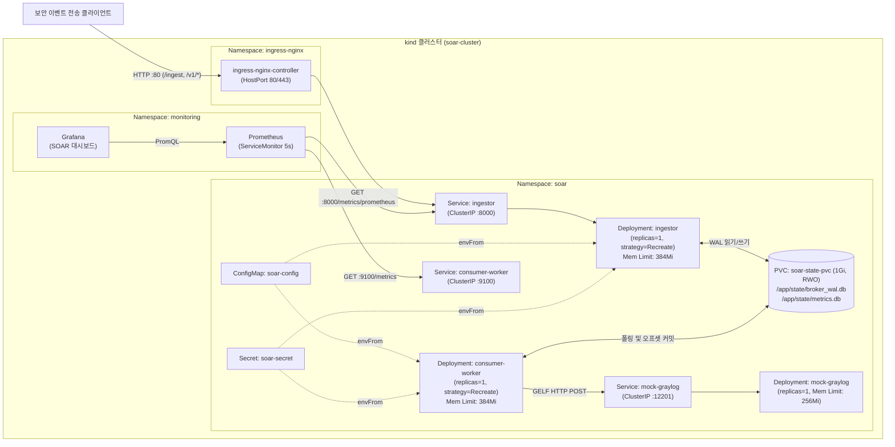

# SOAR 로그 버퍼링 미들웨어 — 쿠버네티스(`kind`) 배포 및 운영 가이드

Docker Compose로 운영하던 SOAR 로그 버퍼링 미들웨어(FastAPI 수집기, SQLite WAL 브로커, 컨슈머 워커, 모의 Graylog 서버)를 로컬 `kind` 클러스터에 옮기고, Helm 차트와 Ingress, Prometheus·Grafana 모니터링을 구성한 문서다.

---

## 1. 아키텍처 구성도



---

## 2. 설계 기준과 이유

### 2.1 `replicas: 1`과 `Recreate` 배포 전략을 쓴 이유
- 이 미들웨어는 외부 메시지 브로커 대신 공유 볼륨(`soar-state-pvc`, `ReadWriteOnce`)에 있는 SQLite WAL 파일(`broker_wal.db`)과 `metrics.db`를 수집기와 컨슈머 워커가 함께 쓴다.
- 기본 배포 전략인 `RollingUpdate`를 쓰거나 레플리카를 2개 이상 띄우면 배포할 때 이전 파드와 새 파드가 동시에 같은 SQLite 파일에 쓰기 잠금을 건다. 이 경우 `database is locked` 에러나 WAL 공유 메모리(`-shm`) 손상이 생길 수 있다.
- 컨슈머 워커가 여러 개 떠도 단일 소비자 그룹의 오프셋 커밋이 겹쳐 중복 전송이 생길 수 있다. 그래서 기존 파드가 완전히 내려가 파일 핸들을 닫은 뒤 새 파드를 띄우는 `Recreate` 전략을 쓰고 레플리카를 1개로 고정했다.

### 2.2 `ServiceMonitor`를 선택한 이유
- 수집기(`ingestor`)는 `/metrics`에서 JSON 통계를 반환하고 Prometheus 메트릭은 8000번 포트의 `/metrics/prometheus`에서 노출한다. 반면 컨슈머 워커(`consumer-worker`)는 9100번 포트의 `/metrics`에서 노출한다.
- `kube-prometheus-stack` 환경에서는 `ServiceMonitor` 리소스를 쓰면 서비스마다 다른 포트(`http` vs `metrics`), 경로(`/metrics/prometheus` vs `/metrics`), 수집 주기(`5s`)를 각각 분리해 관리할 수 있다. Helm 차트 템플릿에 넣어 버전 관리하기에도 알맞아 `ServiceMonitor` 방식을 택했다.

### 2.3 파드 스펙에 `enableServiceLinks: false`를 넣은 이유
- 쿠버네티스는 같은 네임스페이스의 Service 이름(`ingestor`, `mock-graylog`)을 따서 `INGESTOR_PORT=tcp://10.96.x.x:8000`, `MOCK_GRAYLOG_PORT=tcp://10.96.x.x:12201` 환경변수를 모든 파드에 자동 주입한다.
- 이 값이 애플리케이션 `src/config.py`가 정수 포트 번호로 읽는 환경변수 이름과 겹쳐 파드 시작 시 `ValueError`가 났다. 이를 막기 위해 `enableServiceLinks: false`로 자동 환경변수 주입을 끄고 쿠버네티스 DNS(`http://mock-graylog:12201/gelf`)로만 통신하게 했다.

### 2.4 Helm 템플릿 분리 및 보안·데이터 보존 설정
- **Ingress `/metrics` 경로 미노출**: Prometheus 메트릭(`/metrics/prometheus`, `/metrics`)은 클러스터 내부에서 `ServiceMonitor`로만 수집하면 되므로 외부 Ingress 경로 규칙에서는 제외했다.
- **`{{ .Release.Namespace }}` 일원화**: `values.yaml`에 네임스페이스를 따로 두지 않고 모든 템플릿이 `{{ .Release.Namespace }}`를 참조하게 해 `helm upgrade --install -n <namespace>` 명령의 네임스페이스와 어긋나지 않게 했다.
- **PVC 템플릿 분리와 삭제 방지(`helm.sh/resource-policy: keep`)**: `ConfigMap`·`Secret`(`configmap-secret.yaml`)과 `PersistentVolumeClaim`(`pvc.yaml`)을 별도 파일로 분리했다. 파드의 `checksum/config` 해시 대상은 `configmap-secret.yaml`만 바라보게 해 설정값이 바뀔 때만 파드가 재시작되도록 했고, PVC에는 `helm.sh/resource-policy: keep` 어노테이션을 붙여 차트를 삭제(`helm uninstall`)해도 SQLite WAL 데이터가 담긴 볼륨이 지워지지 않게 했다.

---

## 3. 디렉터리 구조

```text
k8s/
├── kind-config.yaml                  # 호스트 80/443 포트 매핑을 넣은 kind 클러스터 설정
├── README.md                         # 실행 순서, 아키텍처 구성도, 설계 기준
├── TROUBLESHOOTING.md                # 구축 중 겪은 문제와 원인·해결 기록
├── POSTMORTEM.md                     # 장애 실험 3건(파드 삭제, 하위 서버 중단, 잘못된 이미지 배포) 기록
├── manifests/                        # 쿠버네티스 매니페스트
│   ├── 00-namespace.yaml
│   ├── 01-configmap.yaml
│   ├── 02-secret.yaml
│   ├── 03-pvc.yaml
│   ├── 04-mock-graylog.yaml
│   ├── 05-ingestor.yaml
│   ├── 06-consumer-worker.yaml
│   ├── 07-ingress.yaml
│   └── 08-servicemonitor.yaml
└── helm/
    └── soar-middleware/              # Helm 차트
        ├── Chart.yaml
        ├── values.yaml
        └── templates/
            ├── configmap-secret.yaml
            ├── pvc.yaml
            ├── ingestor.yaml
            ├── consumer-worker.yaml
            ├── mock-graylog.yaml
            ├── ingress.yaml
            └── servicemonitor.yaml
```

---

## 4. 처음부터 재현하는 실행 순서

클러스터가 없는 상태에서 아래 명령어를 순서대로 실행하면 전체 환경을 똑같이 띄울 수 있다.

### Step 1. `kind` 클러스터 생성 및 이미지 빌드·적재
```powershell
cd C:\Users\user\Desktop\task\netword-team03\scenario1-middleware

# 1. 클러스터 생성 (호스트 80, 443 포트 매핑)
kind create cluster --name soar-cluster --config k8s\kind-config.yaml

# 2. 미들웨어 이미지 빌드 및 kind 노드 적재
docker build -t soar-middleware:1.0.0 .
kind load docker-image soar-middleware:1.0.0 --name soar-cluster
```

### Step 2. `ingress-nginx` 설치
```powershell
helm repo add ingress-nginx https://kubernetes.github.io/ingress-nginx
helm repo update

helm upgrade --install ingress-nginx ingress-nginx/ingress-nginx `
  --namespace ingress-nginx --create-namespace `
  --set controller.hostPort.enabled=true `
  --set controller.service.type=NodePort `
  --set-string controller.nodeSelector."ingress-ready"="true" `
  --set controller.admissionWebhooks.enabled=false

kubectl rollout status deployment/ingress-nginx-controller -n ingress-nginx --timeout=120s
```

### Step 3. `kube-prometheus-stack` (Prometheus & Grafana) 설치
```powershell
helm repo add prometheus-community https://prometheus-community.github.io/helm-charts
helm repo update

helm upgrade --install kube-prometheus-stack prometheus-community/kube-prometheus-stack `
  --namespace monitoring --create-namespace `
  --set alertmanager.enabled=false `
  --set nodeExporter.enabled=false `
  --set kubeStateMetrics.enabled=false `
  --set prometheus.prometheusSpec.serviceMonitorSelectorNilUsesHelmValues=false `
  --set grafana.adminPassword=admin

# 기존 SOAR 대시보드 JSON을 Grafana Sidecar ConfigMap으로 등록
kubectl create configmap soar-grafana-dashboard `
  --from-file=soar_dashboard.json=docs/observability/grafana_dashboard.json `
  -n monitoring --dry-run=client -o yaml | kubectl apply -f -
kubectl label configmap soar-grafana-dashboard grafana_dashboard="1" -n monitoring --overwrite
```

### Step 4. `soar-middleware` Helm 차트 배포 및 동작 확인
```powershell
kubectl create namespace soar --dry-run=client -o yaml | kubectl apply -f -
helm upgrade --install soar-middleware k8s\helm\soar-middleware -n soar

kubectl rollout status deployment/mock-graylog -n soar --timeout=60s
kubectl rollout status deployment/ingestor -n soar --timeout=60s
kubectl rollout status deployment/consumer-worker -n soar --timeout=60s

# Ingress(http://localhost) 경유 헬스체크 및 단건 로그 전송 확인
Invoke-RestMethod -Uri "http://localhost/v1/health" -Method Get
$sample = @{
  client_ip = "10.0.0.99"
  event_type = "HONEYTOKEN_ACCESS"
  target_resource = "/admin/config"
  status_code = 403
  severity = 1
  raw_payload = @{ msg = "README reproduction test" }
} | ConvertTo-Json
Invoke-RestMethod -Uri "http://localhost/ingest" -Method Post -Headers @{ "X-API-Key" = "prod-ingest-key-1"; "Content-Type" = "application/json" } -Body $sample
Invoke-RestMethod -Uri "http://localhost/v1/metrics" -Method Get
```

### Step 5. Prometheus & Grafana 웹 UI 접속 확인 (선택)
```powershell
# Prometheus UI (http://localhost:9090)
kubectl port-forward -n monitoring svc/kube-prometheus-stack-prometheus 9090:9090

# Grafana UI (http://localhost:3000, ID: admin / PW: admin)
kubectl port-forward -n monitoring svc/kube-prometheus-stack-grafana 3000:80
```
