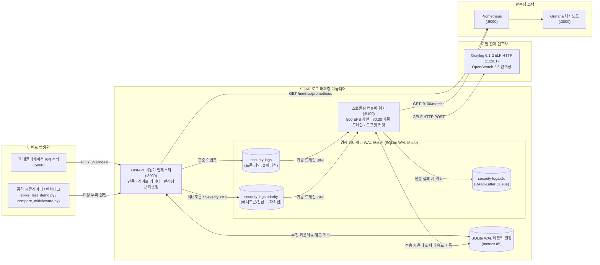

# SOAR 로그 버퍼링 및 트래픽 제어 미들웨어

대량 트래픽이나 침해 공격으로 로그가 급증할 때 하위 SIEM(Graylog)의 과부하를 방지하고 로그를 유실 없이 안전하게 전달하는 경량 로그 파이프라인 미들웨어입니다.

---

## 빠른 시작: Graylog 연동 및 실행

### 1. Graylog 인풋 및 탐지 규칙 설정

#### 1.1 GELF HTTP 인풋 생성
1. Graylog 웹 콘솔(`http://127.0.0.1:9000`)에 접속합니다.
2. 상단 메뉴 System > Inputs로 이동합니다.
3. 드롭다운에서 GELF HTTP를 선택하고 Launch new input을 클릭합니다.
   - Global: 체크
   - Title: `Middleware GELF Ingest`
   - Port: `12201`
   - Bind address: `0.0.0.0`
4. Save를 누르고 인풋 상태가 RUNNING인지 확인합니다.

#### 1.2 SIEM 공격 탐지 규칙 등록
미들웨어가 500 EPS로 평탄화하여 전달한 로그를 기반으로 Graylog에서 공격 탐지 규칙을 생성합니다.
1. 무차별 대입 공격 탐지:
   - Alerts > Event Definitions > Create Event Definition
   - Title: `[S2] Brute Force Attack Detection` (Priority: High)
   - Condition Type: Aggregation
   - Search Query: `status_code:401 OR (event_type:APP_REQUEST AND status_code:401)`
   - Time Range: 1 minute, Execute every: 30 seconds
   - Group by Field: `client_ip`
   - Threshold: `count() >= 5` (1분 내 동일 IP에서 5회 이상 실패 시 경보)
   - Grace Period: 1 minute (동일 IP 중복 알람 억제)
   - Notifications: `S2 n8n Webhook (Brute Force)` 연결
2. 허니토큰 침입 탐지:
   - Title: `[S2] Honeytoken Infiltration Alert` (Priority: Critical)
   - Condition Type: Filter
   - Search Query: `_honeytoken_alert:true OR event_type:HONEYTOKEN_ACCESS`
   - Threshold: `count() > 0` (1회 발생 시 즉시 탐지)

### 2. 도커 컴포즈 실행
기본 설정은 호스트의 Graylog(`http://host.docker.internal:12201/gelf`)로 로그를 전달합니다. `.env` 파일의 `GRAYLOG_GELF_URL`에 콤마(`,`)로 구분하여 복수의 주소를 지정하면 첫 번째 주소는 기존 재시도 및 오프셋 커밋 정책으로 전송하고, 추가 주소로는 동일 배치를 비동기로 복제 전송합니다.

```powershell
# scenario2-middleware 디렉터리로 이동
cd scenario2-middleware

# 환경변수 파일 복사 (필요 시 주소 오버라이드)
Copy-Item .env.example .env

# 미들웨어 및 관측성 스택(Prometheus, Grafana) 동시 실행
docker compose -f docker-compose.yml -f docker-compose.dev.yml --profile observability up -d --build

# 컨테이너 상태 확인
docker compose ps
```

상용 Graylog 없이 로컬 검증 서버로 단독 테스트할 때는 아래 명령을 실행합니다.
```powershell
docker compose -f docker-compose.yml -f docker-compose.mock.yml up -d --build
```

---

### 3. 모니터링 화면 접속
- Grafana 대시보드: `http://127.0.0.1:3000` (`SOAR Middleware Observability` 대시보드 및 Prometheus 데이터소스 자동 등록)
- Prometheus: `http://127.0.0.1:9090`
- 미들웨어 Ingestor 헬스체크: `http://127.0.0.1:8000/v1/health`
- Consumer Worker 메트릭: `http://127.0.0.1:9100/metrics`

---

### 4. 벤치마크 및 검증 스크립트 실행

```powershell
# 1. 미들웨어 유무(A/B) 성능 비교 테스트 (동시성 300, 지연 50ms 완충 실측)
python simulators/compare_middleware.py --logs 5000 --concurrency 300

# 2. 2만 건 스파이크 완충 및 5단계 무손실 감사 리포트 검증
python simulators/spike_test_demo.py --spike-count 20000

# 3. 연속 고부하 안정성 테스트 (20,000건 x 2회)
python simulators/load_test_20k.py

# 4. 전체 단위 및 통합 테스트 스위트 실행 (191개 테스트 전량 통과)
pytest -v
```

---

## 1. 핵심 설계 목표

### 1.1 트래픽 평탄화와 하위 인프라 보호
수천 건의 로그가 순간 유입될 때 FastAPI 기반 비동기 HTTP 수집기([`src/ingestor.py`](file:///c:/Users/user/Desktop/task/netword-team03/scenario2-middleware/src/ingestor.py), 포트 8000)가 요청을 지연 없이 수락합니다. 수신한 로그는 디스크 기반 WAL 브로커(`broker_wal.db`, 3개 파티션)에 안전하게 버퍼링합니다. 백그라운드 컨슈머 워커([`src/consumer_worker.py`](file:///c:/Users/user/Desktop/task/netword-team03/scenario2-middleware/src/consumer_worker.py))는 토큰 버킷 레이트 리미터(`MAX_LOGS_PER_SEC=500.0`)와 마이크로 배칭(`BATCH_SIZE=100`, `BATCH_LINGER_MS=100`)을 적용하여 하위 Graylog가 수용 가능한 초당 500건 이하로 트래픽을 엄격히 제어하며 전달합니다.

### 1.2 최소 1회 전송과 멱등성 기반 무손실 파이프라인
최소 1회(At-Least-Once) 전송 보장과 멱등성 키(`_event_id`)를 조합하여 파이프라인 데이터 정합성을 유지합니다. 프로듀서는 인메모리 유계 큐와 백그라운드 배치 커밋 스레드를 통해 WAL 디스크에 기록하며, 큐 용량이나 미소비 래그 한도를 초과하면 즉시 HTTP 503 백프레셔를 반환하여 상위 서비스 장애 전파를 방지합니다. 컨슈머는 Graylog의 HTTP 2xx 응답이나 DLQ 격리를 확인한 뒤에만 파티션별 최대 오프셋(`max_offset + 1`)을 동기 커밋합니다. GELF 페이로드에는 `{partition}:{offset}` 형태의 고유 키를 부여하여 네트워크 재전송 시에도 하위 수신단에서 중복 로그를 식별할 수 있도록 지원합니다. 하위 장애 발생 시에는 지수 백오프로 대기하되 파티션을 일시 정지(`pause`)하여 메시지 디큐 없이 세션 하트비트를 유지합니다.

### 1.3 프로듀서 핫패스 논블로킹 아키텍처
수집 요청을 처리하는 `produce()` 핫패스에서 동기 SQLite 조회를 배제하여 이벤트 루프 블로킹을 원천 제거했습니다. 미소비 큐 적체량(`unconsumed_lag`)은 FastAPI `lifespan`에 등록된 백그라운드 태스크가 `asyncio.to_thread`를 통해 1초 주기로 갱신하며 프로듀서는 인메모리 캐시값만 참조합니다. 토픽별 파티션 수는 런타임에 불변이므로 최초 1회 조회 후 인메모리에 캐싱합니다. 이를 통해 백그라운드 쓰기 스레드의 트랜잭션 락(`BEGIN IMMEDIATE`)과 수집 스레드 간 경합을 차단했습니다.

### 1.4 공격자 IP 기준 순서 보장과 70:30 가중 드레인
`client_ip`를 파티션 키로 지정(`crc32(client_ip) % 3`)하여 동일 공격자 IP의 연속 공격 이벤트는 동일 파티션에 시계열 순서대로 적재되고 소비됩니다. 기만 공격 탐지(`HONEYTOKEN_ACCESS`)와 고위험 이벤트(`severity <= 2`)는 우선순위 토픽(`security-logs.priority`)으로 분기 라우팅합니다. 컨슈머는 70:30 가중 드레인 알고리즘을 사용하여 일반 로그 백로그가 누적된 상태에서도 허니토큰 경보를 지연 예산(2.0초 미만) 내에 먼저 전달하며, 동시에 표준 레인 지분을 최소 30% 보장하여 일반 트래픽의 기아 현상을 방지합니다.

---

## 2. Kafka 대신 자체 경량 WAL 브로커를 구현한 이유

대규모 분산 환경에서는 Apache Kafka가 표준이지만, 단일 노드 보안 인프라와 온프레미스 배포 환경을 고려하여 자체 경량 WAL 브로커([`src/middleware/lightweight_broker.py`](file:///c:/Users/user/Desktop/task/netword-team03/scenario2-middleware/src/middleware/lightweight_broker.py), `broker_wal.db`)를 구현했습니다.

### 2.1 JVM 및 인프라 오버헤드 제거
Kafka 브로커는 JVM 기반으로 컨테이너당 수백 MB에서 1GB 이상의 메모리를 점유하며 기동과 메타데이터 동기화에도 상당한 시간이 소요됩니다. 자체 브로커는 파이썬 표준 라이브러리와 SQLite WAL 모드(`PRAGMA journal_mode=WAL`)로 동작하여 컨테이너 384MB 메모리 제한 내에서도 안정적으로 구동되며 기동 즉시 트래픽을 처리합니다.

### 2.2 C 바이너리 컴파일 의존성 제거
`confluent-kafka` 라이브러리는 C 기반 `librdkafka` 바이너리 빌드 의존성을 갖습니다. 표준 SQLite 엔진을 활용함으로써 별도의 C 네이티브 컴파일 환경 구성 없이 모든 운영체제에서 동일하게 동작하도록 이식성을 확보했습니다.

### 2.3 Kafka 호환 인터페이스 유지
외부 브로커 프로세스는 제거했으나 IP 기반 CRC32 파티셔닝, 파티션별 단조 증가 오프셋, 컨슈머 그룹 오프셋 커밋, 워터마크 기반 래그 계산, Pause/Resume 기반 디큐 제어 등 핵심 메시징 메커니즘을 동일하게 구현했습니다. 추후 멀티 노드 확장이 필요할 때 상위 비즈니스 로직 수정 없이 외부 Kafka 클라이언트로 교체할 수 있도록 덕 타이핑 인터페이스를 맞췄습니다.

---

## 3. 시스템 아키텍처



---

## 4. 디렉터리 및 주요 컴포넌트 구조

| 경로 | 설명 |
| :--- | :--- |
| [`Dockerfile`](./Dockerfile) | Python 3.11-slim 기반 멀티스테이지 빌드 및 비루트 계정(`appuser:10001`) 실행 환경 |
| [`docker-compose.yml`](./docker-compose.yml) | Ingestor, Consumer Worker, Prometheus, Grafana 프로비저닝 구성 |
| [`src/config.py`](./src/config.py) | Pydantic v2 기반 파이프라인 환경변수 검증 모델 (`PipelineSettings`) |
| [`src/ingestor.py`](./src/ingestor.py) | FastAPI 비동기 수집기, 백그라운드 래그 캐시 갱신 루프, 레이트 리미터, 헬스체크 |
| [`src/consumer_worker.py`](./src/consumer_worker.py) | 컨슈머 오케스트레이터, 마이크로 배칭, 70:30 가중 드레인, 백오프 및 오프셋 커밋 |
| [`src/metrics_store.py`](./src/metrics_store.py) | SQLite WAL 기반 메트릭 스토어 (`SharedMetricsStore`), 슬라이딩 윈도우 EPS 계산 |
| [`src/middleware/`](./src/middleware/) | 경량 WAL 브로커, 토큰 버킷, GELF 변환기, 전송 클라이언트, DLQ 퍼블리셔 |
| [`simulators/compare_middleware.py`](./simulators/compare_middleware.py) | 미들웨어 유무(Direct Graylog vs SOAR Middleware) A/B 벤치마크 도구 |
| [`simulators/spike_test_demo.py`](./simulators/spike_test_demo.py) | 2만 건 스파이크 인입, 드레인 모니터링 및 5단계 무손실 감사 리포트 검증 도구 |
| [`simulators/load_test_20k.py`](./simulators/load_test_20k.py) | 2만 건 연속 부하 주입 및 `produce()` 핫패스 무중단 검증 스크립트 |
| [`simulators/run_scenarios.py`](./simulators/run_scenarios.py) | 웹앱 공격 차단(1), 정상 트래픽 평탄화(2), 킬체인 및 허니토큰(3) 시나리오 실행기 |
| [`docs/observability/`](./docs/observability/) | Grafana 대시보드 JSON, 자동 프로비저닝 설정 및 Prometheus 알람 규칙 |

---

## 5. 검증 시나리오 및 벤치마크 결과

| 시나리오 | 실행 명령어 | 실측 결과 |
| :--- | :--- | :--- |
| 미들웨어 유무(A/B) 실측 비교 | `python simulators/compare_middleware.py --count 1000 --concurrency 100` | 하위 지연 50ms 발생 시 직접 전송 대조군은 클라이언트가 6.35초(157 req/s) 동안 블로킹되나, 미들웨어 경유군은 2.99초(335 logs/s) 만에 조기 반환(유실률 0.0%). 벌크 배치 수집(7,600~11,000 logs/s) 후 초당 500건으로 엄격히 평탄화 |
| 2만 건 스파이크 무손실 검증 | `python simulators/spike_test_demo.py --spike-count 20000` | 다중 키 배치 수집으로 4.5초 만에 20,004건 인입(집계 버스트 4,448 logs/s). 최대 18,501건 WAL 디스크 버퍼링 후 초당 500건 상한으로 37.4초 동안 드레인 완료(유실 0건) |
| 연속 고부하 안정성 검증 | `python simulators/load_test_20k.py` | 20,000건 연속 2회(총 40,000건) 배치 인입 시 ReadError 0건. 회차당 8.7~9.5초 소요 (평균 2,100~2,280 logs/s) |
| 웹앱 공격 탐지 및 자동 차단 | `python simulators/run_scenarios.py -s 1` | 비허용 IP 접근 시 HTTP 403 응답 및 인시던트 티켓 발급. SOAR 웹훅 연동으로 공격자 IP 자동 차단 및 침해 로그 보존 |
| 킬체인 순서 보장 및 허니토큰 | `python simulators/run_scenarios.py -s 3` | 백로그 적체 상황에서 허니토큰 경보를 2.0초 이내(실측 0.045초)에 우선 전송. 공격자 IP 기반 CRC32 파티셔닝으로 공격 단계 시계열 순서 유지 |
| SIEM 장애 시 백오프 복구 | `python simulators/spike_test_demo.py --simulate-outage` | Graylog 503 응답 시 컨슈머 파티션 일시 정지 및 지수 백오프 대기. 복구 즉시 전송을 재개하여 유실 없이 전량 적재 |
| 단위 및 통합 테스트 스위트 | `pytest -v` | 파티셔닝, 오프셋 커밋, HMAC 서명, GELF 분할 전송, DLQ 격리, 마스킹 등 191개 테스트 전량 통과 |

---

## 6. API 엔드포인트 명세

| 메서드 & 경로 | 상태 코드 | 설명 |
| :--- | :--- | :--- |
| `GET /v1/health` | `200 OK` / `503` | 인제스터 상태, 브로커 토픽 및 SQLite WAL 쓰기 락 상태 검사 |
| `POST /v1/ingest` | `202 Accepted` | 단일 보안 이벤트 검증 및 `client_ip` 파티션 키 기반 브로커 비동기 적재 |
| `POST /v1/ingest/batch` | `202 Accepted` | 다건 보안 이벤트 배열 일괄 수집 |
| `GET /v1/metrics` | `200 OK` | 실시간 파이프라인 지표 JSON 반환 (처리량, 큐 적체량, 5단계 원장 수치) |
| `GET /v1/metrics/prometheus` | `200 OK` | Prometheus 텍스트 포맷 메트릭 노출 |
| `GET /v1/admin/dlq` | `200 OK` | [Admin] DLQ 및 포이즌 토픽 적체 메시지 수 조회 |
| `POST /v1/admin/dlq/replay` | `200 OK` | [Admin] DLQ 메시지를 메인 토픽으로 지정 건수만큼 재전송 |
| `POST /v1/metrics/reset` | `200 OK` | [Admin] 메트릭 원장 카운터 및 처리량 버킷 초기화 |

---

## 7. 메트릭 원장 분리와 5단계 무손실 감사 리포트

유실(`permanently_dropped_logs`)과 일시 격리(`dlq_quarantined_logs`)를 분리하여 아래 회계 불변식을 검증합니다.

$$\text{Total Sent} = \text{Total Received} = \text{Total Forwarded} + \text{permanently\_dropped} + \text{dlq\_quarantined} = \text{Graylog Stored}$$

```text
[5-STAGE END-TO-END ZERO-LOSS & BACKPRESSURE AUDIT REPORT]
  1. [Stage 1] Attack Load Generator Sent       : 20,004 logs (Burst Rate: 4,448 logs/sec)
  2. [Stage 2] HTTP Ingestor Accepted           : 20,004 logs (Peak Inbound: 4,448 logs/sec, permanently_dropped: 0)
  3. [Stage 3] Lightweight WAL Broker Buffered  : 20,004 logs (Peak Queue Lag Buffered: 18,501 logs)
  4. [Stage 4] Consumer Worker Throttled Commit : 20,004 logs (Peak Outbound: 500 / Limit: 500 logs/sec, dlq_quarantined: 0)
  5. [Stage 5] Graylog GELF Server Stored       : 20,004 logs (Duplicates Deduped: 0, DLQ Replayed: 0)
  • Priority Lane (Honeytoken) Latency    : 0.045s (Budget: < 2.0s) [PASS]

================================================================================================================
 [PASS] SCENARIO 2 VERIFIED: 100% SPIKE BUFFERED & 0.0000% LOG LOSS
        Sent (20,004) == Received (20,004) == Forwarded (20,004) + permanently_dropped (0) == Graylog Stored (20,004)
================================================================================================================
```

---

## 8. 보안 기능

### 8.1 API 인증 및 권한 분리
`X-API-Key` 헤더를 상수 시간(`hmac.compare_digest`)으로 비교하여 타이밍 공격을 방지합니다. 요청 본문 HMAC-SHA256 서명(`X-Timestamp`, `X-Signature`) 검증과 300초 재생 공격 방지 윈도우를 지원합니다. 수집 키(`INGEST_API_KEYS`)와 관리자 키(`ADMIN_API_KEY`)를 분리하여 관리자 API 접근을 통제합니다.

### 8.2 API 키 단위 수집 속도 제한 및 인메모리 해시 격리
메모리 덤프나 로그에 평문 API 키가 노출되지 않도록 SHA-256 해시값(`hashlib.sha256(key).hexdigest()`)을 버킷 키로 사용하여 토큰 버킷을 운용합니다. IP 스푸핑 공격에 따른 메모리 급증을 방지하며 한도 초과 시 HTTP 429와 `Retry-After` 헤더를 반환합니다.

### 8.3 민감정보 자동 마스킹
브로커 적재 전에 `raw_payload` 내부 민감 필드를 `"[REDACTED]"`로 치환합니다. 대상 필드는 `password`, `passwd`, `token`, `api_key`, `secret`, `authorization`, `cookie`, `session` 등이며 대소문자 구분 없이 중첩 JSON 구조까지 재귀적으로 탐색하여 비식별화합니다.

---

## 9. 관측성 및 모니터링

### 9.1 Prometheus 메트릭 노출
수집 및 전송 카운터(`logs_received_total`, `logs_forwarded_total`, `logs_permanently_dropped_total`, `dlq_published_total`), 큐 및 파이프라인 상태 게이지(`queue_lag{topic, partition}`, `dlq_depth`, `configured_max_logs_per_sec`, `invariant_violations`), 지연 시간 히스토그램(`graylog_delivery_latency_seconds`, `batch_size`, `end_to_end_latency_seconds`)을 수집 엔드포인트와 컨슈머 포트(:9100)를 통해 표준 텍스트 포맷으로 노출합니다.

### 9.2 Grafana 대시보드 자동 프로비저닝
컨테이너 기동 시 Prometheus 데이터소스와 대시보드가 프로비저닝 설정을 통해 자동 등록됩니다. 인입 및 방출 EPS, 파티션별 큐 적체량, 토큰 버킷 처리 속도, DLQ 깊이 등을 별도의 수동 조작 없이 웹 UI에서 실시간으로 관측할 수 있습니다.

---

## 10. 한계점 및 운영 고려사항

### 10.1 단일 호스트 SQLite WAL 스토리지 특성
현재 브로커는 단일 호스트 로컬 볼륨(`/app/state`) 위에서 동작합니다. 단일 노드 환경에서는 수천 EPS 스파이크를 유실 없이 완충할 수 있으나, 다중 서버로 수평 확장할 때는 NFS 등 네트워크 파일 시스템에서의 파일 락 경합과 WAL 인덱스 손상을 방지하기 위해 외부 Kafka나 Redpanda 클러스터로 전환해야 합니다.

### 10.2 트래픽 평탄화에 따른 일반 로그 지연
초당 수천 건의 스파이크 트래픽을 초당 500건으로 제한하므로 대량 유입 시 일반 로그의 꼬리 지연 시간(p99)이 수 초간 증가합니다. 이는 하위 Graylog와 OpenSearch의 과부하 및 큐 포화를 막기 위한 설계상 트레이드오프입니다. 긴급한 침해 경보는 70:30 가중 드레인 우선순위 레인을 통해 2.0초 이내에 우선 전달됩니다.

### 10.3 클라이언트 Fail-Open 원칙
미들웨어 장애가 비즈니스 API 서버나 IoT 기기로 전파되지 않도록 [`simulators/client_integration_snippet.py`](file:///c:/Users/user/Desktop/task/netword-team03/scenario2-middleware/simulators/client_integration_snippet.py)의 `SafeSecurityLogClient`는 비동기 유계 큐와 서킷 브레이커 패턴으로 구현되었습니다. 미들웨어 연속 실패 시 서킷을 열고 로컬 폴백 파일(`client_fallback_logs.jsonl`)에 우회 기록하여 본 서비스의 연속성을 보장합니다.
