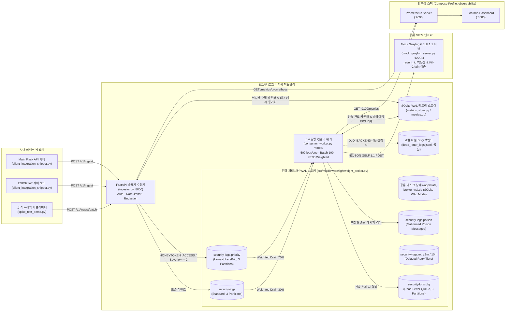

# SOAR 경량 로그 버퍼링 및 트래픽 제어 미들웨어 (Zero-Loss Log Pipeline)

본 프로젝트는 대규모 사이버 공격(Nmap 포트 스캔, Hydra 무차별 대입 공격, 비인가 API/IoT 제어 등) 발생 시 폭증하는 보안 로그(Massive Log Spike)로부터 **하위 SIEM(Graylog) 인프라의 과부하 및 장애를 방지**하고, **`총 전송 로그 수 == 총 저장 로그 수 (0.00% 로그 유실)`** 및 **공격자 IP별 시계열 순서 보장(Kill-Chain Ordering)**을 증명하기 위해 설계된 **경량 분산 로그 파이프라인 미들웨어**입니다.

---

## 1. 핵심 설계 목표 (Core Objectives)

1. **대규모 로그 스파이크 완충 및 스로틀링 제어 (Infrastructure Stability)**
   - 수천 건의 보안 로그가 1~2초 내에 유입되는 버스트(Burst) 상황에서 비동기 HTTP 수집기([`ingestor.py`](./ingestor.py) :8000, `FastAPI` + 경량 논블로킹 프로듀서)가 로그를 수용하고 **파티셔닝 WAL 브로커(3 Partitions)**에 버퍼링합니다.
   - 컨슈머 워커([`consumer_worker.py`](./consumer_worker.py))는 **로그 단위 토큰 버킷 레이트 리미터(`MAX_LOGS_PER_SEC=500.0`)**와 **마이크로 배칭(`BATCH_SIZE=100`, `BATCH_LINGER_MS=100`)**을 통해 Graylog가 안정적으로 처리할 수 있는 속도로 평탄화(Traffic Shaping)하여 전달합니다.

2. **무결성 및 무손실 로그 전송 증명 (`Total Sent == Total Stored, 0.0000% Log Loss`)**
   - **전송 시맨틱 (Delivery Semantics)**: 본 미들웨어는 **최소 1회 전송(At-Least-Once delivery) + 결정론적 멱등성 키(`_event_id`)** 모델로 동작합니다. 본 시스템은 분산 트랜잭션을 통한 Exactly-Once를 제공하지 않으며, At-Least-Once 전송과 하위 계층의 멱등성 중복 제거 결합을 통해 데이터 정합성을 달성합니다.
   - **Producer**: WAL 디스크 영속화 확인 전까지 유실을 방지하며, 버퍼 포화 시 `BufferError` 기반 즉시 백프레셔(HTTP 503)를 반환합니다.
   - **Consumer**: Graylog의 `HTTP 2xx` 응답 또는 DLQ 영속화 완료를 확인한 직후에만 해당 배치의 파티션별 정확 오프셋(`TopicPartition(topic, partition, max_offset + 1)`)을 동기 커밋(`asynchronous=False`)합니다.
   - **결정론적 멱등성 키(`_event_id`)**: GELF 1.1 페이로드에 결정론적 멱등성 키(`_event_id = "{partition}:{offset}"`)를 부여하여 네트워크 지연이나 재전송 시 하위 수신 측에서 중복 적재를 식별·제거할 수 있도록 지원합니다.
     > [!IMPORTANT]
     > `_event_id` 기반 멱등성 중복 제거는 현재 테스트용 에뮬레이터인 [`mock_graylog_server.py`](./mock_graylog_server.py)에만 인메모리 캐시(`_seen_event_ids`)로 구현되어 있습니다. 실제 상용 Graylog 및 OpenSearch/Elasticsearch 환경에서 진정한 멱등 적재를 구현하려면 문서 `_id`를 `{topic}:{partition}:{offset}`(또는 `_event_id`)으로 매핑하는 Ingest Pipeline을 직접 구성해야 합니다. 본 프로젝트에는 상용 OpenSearch Ingest Pipeline 코드가 번들되어 있지 않습니다.
   - **지수 백오프(Exponential Backoff + Jitter) & Pause 기반 하트비트 보존**: Graylog 장애(`HTTP 5xx`/연결 거부) 시 지수 백오프로 대기하며, 백오프 중 할당된 파티션을 일시 정지(`consumer.pause`)하여 `poll(0)`이 호출되더라도 메시지를 디큐하지 않고 보존합니다.
   - **다중 계층 DLQ(Dead-Letter Queue) & 포이즌 메시지 격리**: 유한 재시도 초과 배치는 경량 DLQ 토픽(`security-logs.dlq`) 또는 로컬 파일(`dead_letter_logs.jsonl`)로 영속화하고, 파싱 불가능한 손상 메시지는 포이즌 토픽(`security-logs.poison`)으로 즉시 격리 후 오프셋을 커밋하여 파티션 블로킹을 방지합니다.

3. **공격자 IP 기반 Kill-Chain 시계열 순서 보장 및 우선순위 레인(Priority Lane)**
   - `client_ip`를 파티션 키로 지정(`crc32(client_ip) % num_partitions`)하여 동일 공격자(`10.0.0.99`)의 연속 공격 단계(`PORT_SCAN` $\rightarrow$ `BRUTE_FORCE` $\rightarrow$ `IOT_CONTROL`)가 동일 파티션에 엄격한 발생 시각(`timestamp`) 순서대로 적재 및 소비되도록 보장합니다.
   - 기만 공격 탐지(`HONEYTOKEN_ACCESS`) 및 고위험 이벤트(`severity <= 2`)는 우선순위 토픽(`security-logs.priority`)으로 분기 라우팅됩니다. 컨슈머는 **70:30 가중 드레인(Weighted Draining)**을 적용하여 대규모 스캔 백로그 상황에서도 허니토큰 경보를 지연 예산(기본 2.0초 미만) 내에 최우선 전달하되 일반 트래픽의 기아(Starvation)를 방지합니다.

### Why Custom Lightweight WAL Broker Instead of Apache Kafka?

전통적인 대규모 엔터프라이즈 환경에서는 **Apache Kafka**가 대용량 메시징의 표준으로 널리 사용됩니다. 그러나 본 프로젝트가 무거운 외부 브로커 클러스터 대신 자체 **Lightweight Partitioned WAL Broker ([`src/middleware/lightweight_broker.py`](./src/middleware/lightweight_broker.py), `broker_wal.db`)**를 설계·구현한 이유는 다음과 같습니다:

1. **JVM 및 인프라 오버헤드 제거 (Zero JVM Overhead)**:
   - Apache Kafka 컨테이너는 JVM 런타임으로 인해 최소 768MB~1GB 이상의 시스템 메모리를 점유하며, 브로커 기동 및 메타데이터 초기화에 20초 이상의 대기 시간이 발생합니다.
   - 본 프로젝트의 경량 브로커는 Python 표준 라이브러리와 SQLite WAL 모드(`PRAGMA journal_mode=WAL`)를 기반으로 설계되어 **메모리 점유율을 수십 MB 수준으로 대폭 절감**하고, 별도의 브로커 컨테이너 없이 공유 볼륨 상에서 즉시 기동됩니다.

2. **C-바인딩 의존성(`confluent-kafka` / `librdkafka`) 탈피**:
   - `confluent-kafka`는 C 컴파일러 및 운영체제별 네이티브 바이너리 의존성(`librdkafka`)이 요구되어 에지 환경, 크로스 플랫폼 개발 및 경량 컨테이너 패키징에 제약이 있었습니다.
   - 자체 브로커는 순수 파이썬 환경과 표준 SQLite 엔진을 활용하여 C 컴파일러 없는 순수 파이썬 환경에서도 동일한 안정성을 제공합니다.

3. **Kafka 핵심 분산 시맨틱의 충실한 재현**:
   - 무거운 외부 브로커 클러스터는 걷어냈지만, Apache Kafka의 핵심 분산 시맨틱인 **① 공격자 IP 기반 CRC32 해시 파티셔닝(Kill-Chain 순서 보장)**, **② 파티션별 엄격한 0-기반 단조 증가 연속 오프셋(Strictly Monotonic Contiguous Offsets)**, **③ 명시적 컨슈머 그룹 오프셋 커밋(Explicit Commits)**, **④ 워터마크 기반 래그(Lag) 계산**, **⑤ Pause/Resume 기반 디큐 제어**를 완벽하게 재현했습니다.

---

## 2. 시스템 아키텍처 (System Architecture)



---

## 3. 디렉터리 및 파일 구조 (Repository Structure)

| 파일 / 디렉터리 경로 | 역할 및 주요 기능 |
| :--- | :--- |
| [`.dockerignore`](./.dockerignore) | Docker 빌드 컨텍스트에서 가상환경(`.venv`), 캐시(`__pycache__`), 테스트/런타임 상태 파일 제외 |
| [`Dockerfile`](./Dockerfile) | Python 3.11-slim 기반 멀티스테이지 컨테이너 빌드 및 비루트 사용자(`appuser:10001`) 보안 실행 환경 |
| [`README.md`](./README.md) | 전체 아키텍처, 엔드포인트 명세, 환경변수, 실행 가이드 및 프로덕션 고려사항 종합 문서 |
| [`developmentlog.md`](./developmentlog.md) | 파이프라인 구축 및 리팩토링 과정에서 직면한 문제 해결 기록(Development Log) 및 향후 로드맵 |
| [`docker-compose.yml`](./docker-compose.yml) | Mock Graylog, Ingestor, Consumer Worker 및 Observability 프로파일(Prometheus, Grafana) 오케스트레이션 (공유 볼륨 기반 경량 브로커 연동) |
| [`docker-compose.dev.yml`](./docker-compose.dev.yml) | 로컬 개발 및 벤치마크용 Compose 오버라이드 (인증 비활성화, 수집 레이트 리미터 상향) |
| [`pyproject.toml`](./pyproject.toml) | 프로젝트 메타데이터, 의존성 선언, pytest 및 ruff/mypy 도구 설정 |
| [`requirements.txt`](./requirements.txt) | FastAPI, uvicorn, pydantic, httpx, prometheus-client, opentelemetry 등 프로덕션/테스트 런타임 의존성 목록 |
| [`src/config.py`](./src/config.py) | Pydantic v2 기반 타입 검증 설정 모델(`PipelineSettings`, `load_settings`). 브로커, 토픽, 배칭, 레이트 리미터 설정 검증 |
| [`src/ingestor.py`](./src/ingestor.py) | FastAPI 비동기 수집기. Pydantic 스키마 검증, 비차단 브로커 프로듀서, PII 마스킹, 레이트 리미터, `/v1` 버전 관리 및 메트릭/DLQ 관리자 API |
| [`src/consumer_worker.py`](./src/consumer_worker.py) | 컨슈머 오케스트레이터(`GraylogConsumerWorker`). 마이크로 배칭, 70:30 가중 드레인, pause 기반 백오프, 리밸런스 콜백 및 포트 9100 프로메테우스 데몬 구동 |
| [`src/metrics_store.py`](./src/metrics_store.py) | SQLite WAL 기반 프로세스 간 공유 원자적 메트릭 스토어(`SharedMetricsStore`). 카운터 분리, 슬라이딩 EPS 버킷, 불변식 롤백 보호 |
| [`src/middleware/`](./src/middleware/) | 경량 파티셔닝 WAL 로그 브로커, 토큰 버킷 레이트 리미터, GELF 변환기, 지수 백오프 전송 클라이언트, DLQ 퍼블리셔 등 핵심 라이브러리 모듈 패키지 |
| [`simulators/mock_graylog_server.py`](./simulators/mock_graylog_server.py) | Graylog HTTP GELF 1.1 입력 에뮬레이터. `_event_id` 중복 제거, Kill-Chain 순서/파티션 검증, HTTP 503 장애 주입(`/outage/on`, `/outage/off`) |
| [`simulators/spike_test_demo.py`](./simulators/spike_test_demo.py) | 5,000건 대규모 비동기 스파이크 + Kill-Chain + Honeytoken 주입, 실시간 드레인 모니터링 및 **5단계 무손실 감사 리포트** 자동화 스크립트 |
| [`simulators/client_integration_snippet.py`](./simulators/client_integration_snippet.py) | Main Flask API 서버(`requests`) 및 ESP32 IoT 보드(`urequests`) 연동용 경량 클라이언트 코드 스니펫 |
| [`docs/observability/alerts.yml`](./docs/observability/alerts.yml) | Prometheus Alertmanager 경보 규칙 정의 (`HighQueueLag`, `DLQDepthNonZero`, `GraylogHigh5xxRate`, `InvariantViolationsDetected`, `ConsumerNotProgressing`) |
| [`docs/observability/grafana_dashboard.json`](./docs/observability/grafana_dashboard.json) | Grafana 11.2 대시보드 프로비저닝 JSON (EPS 처리량, 큐 지연, 토큰 버킷 속도, DLQ 깊이, 엔드투엔드 지연시간 시각화) |
| [`docs/observability/prometheus.yml`](./docs/observability/prometheus.yml) | Prometheus 서버 스크랩 설정 (Ingestor :8000/metrics/prometheus 및 ConsumerWorker :9100/metrics) |
| [`tests/conftest.py`](./tests/conftest.py) | 단위 및 통합 테스트를 위한 전역 fixture 정의 |
| [`tests/test_middleware.py`](./tests/test_middleware.py) | 스키마 정규화, 버퍼링, GELF 변환, 레이트 리미터, 기본 컨슈머 파이프라인 계약을 검증하는 32개 테스트 |
| [`tests/test_refactored_components.py`](./tests/test_refactored_components.py) | 설정 검증, 격리 모듈, 결함 주입, 분리 원장 불변식, 리밸런스/우아한 종료를 검증하는 23개 테스트 |
| [`tests/test_broker_dlq_and_admin.py`](./tests/test_broker_dlq_and_admin.py) | 스키마 버전 관리, 브로커 DLQ 퍼블리셔, 포이즌 메시지 격리, 지연 재시도, 다중 워커 보존 법칙, 관리자 DLQ API를 검증하는 16개 테스트 |
| [`tests/test_priority_lane.py`](./tests/test_priority_lane.py) | 우선순위 라우팅, 가중치 드레인(70:30), 멀티 토픽 오프셋 커밋, 허니토큰 지연시간, 레인별 텔레메트리를 검증하는 19개 테스트 |
| [`tests/test_security_and_api.py`](./tests/test_security_and_api.py) | PII 마스킹, API Key/HMAC 다중 인증, 식별자 레이트 리미터, RFC 7807 오류 응답, `/v1` 버전 관리 헤더를 검증하는 19개 테스트 |
| [`tests/test_observability.py`](./tests/test_observability.py) | Prometheus 엔드포인트, 컨슈머 메트릭 포트, 확정 이벤트 카운터 증가 원칙, OpenTelemetry W3C 전파를 검증하는 13개 테스트 |
| [`tests/test_lightweight_broker.py`](./tests/test_lightweight_broker.py) | 경량 브로커의 CRC32 파티셔닝, 연속 오프셋, pause/resume 디큐 제어, 워터마크 계산, 멀티프로세스 동시성을 검증하는 15개 테스트 |

---

## 4. 시작하기 및 실행 방법 (Quick Start)

### 4.1 Docker Compose 기반 파이프라인 구동

```bash
# 전체 컨테이너 빌드 및 백그라운드 구동 (Ingestor + Consumer Worker + Mock Graylog, 외부 브로커 불필요)
docker compose up -d --build

# 개발/데모 환경 실행 (인증 비활성화 및 높은 수집 한도 적용)
docker compose -f docker-compose.yml -f docker-compose.dev.yml up -d

# Prometheus 및 Grafana 관측성 스택 포함 실행
docker compose --profile observability up -d

# 실행 중인 컨테이너 상태 및 헬스체크 확인
docker compose ps
```

### 4.2 대규모 로그 스파이크 및 무손실 검증 데모 실행

```bash
# 기본 5,000건 스파이크 + Kill-Chain(3건) + Honeytoken(1건) = 총 5,004건 무손실 검증
python spike_test_demo.py --spike-count 5000

# 드레인 도중 Mock Graylog HTTP 503 장애 주입 및 지수 백오프 자동 복구 시뮬레이션 포함
python spike_test_demo.py --spike-count 5000 --simulate-outage

# 허니토큰 지연시간 예산 커스텀 지정 (기본 2.0초)
python spike_test_demo.py --spike-count 5000 --honeytoken-latency-budget 2.0

# 스크립트 CLI 옵션 도움말 확인
python spike_test_demo.py --help
```

### 4.3 단위 및 통합 테스트 실행 (Pytest)

별도의 외부 브로커 프로세스 없이도 내장된 경량 WAL 브로커를 통해 모든 단위, 통합, 결함 주입 및 보안 테스트를 로컬에서 즉시 실행할 수 있습니다.

```bash
# 전체 152개 단위/통합/결함주입 테스트 실행
pytest -v
```

---

## 5. 주요 API 엔드포인트 명세 (API Reference)

### 5.1 인증 및 오류 형식 규격
- **인증 방식**: `AUTH_ENABLED=true` 설정 시 모든 API 요청은 아래 둘 중 하나의 헤더를 포함해야 합니다:
  - `X-API-Key: <키>`: 상수 시간 비교(`hmac.compare_digest`) 인증.
  - `X-Timestamp: <Unix Epoch>` 및 `X-Signature: <HMAC-SHA256 hex>`: 요청 바디에 대한 서명 검증 (300초 재생 방지 윈도우).
- **역할 분리**:
  - 인제스트 권한(`require_ingest_auth`): `POST /v1/ingest`, `POST /v1/ingest/batch`
  - 관리자 권한(`require_admin_auth`): `GET /v1/admin/dlq`, `POST /v1/admin/dlq/replay`, `POST /v1/metrics/reset`
- **통일 오류 규격**: 모든 4xx/5xx 응답은 RFC 7807 `application/problem+json` 형식으로 반환됩니다:
  ```json
  {
    "type": "about:blank",
    "title": "Too Many Requests",
    "status": 429,
    "detail": "Rate limit exceeded for client identity. Retry after 1s.",
    "instance": "/v1/ingest"
  }
  ```

### 5.2 HTTP Ingestor 엔드포인트 (`http://localhost:8000`)

| 메서드 & 경로 | 레거시 경로 (Deprecation: true) | 상태 코드 | 설명 |
| :--- | :--- | :--- | :--- |
| `GET /v1/health` | `GET /health` | `200 OK` | 인제스터 기동 상태, 브로커 토픽 및 인플라이트 큐 크기 반환 |
| `POST /v1/ingest` | `POST /ingest` | `202 Accepted` | 단일 보안 이벤트 JSON 검증 및 `client_ip` 파티션 키로 경량 브로커 비동기 버퍼링 |
| `POST /v1/ingest/batch` | `POST /ingest/batch` | `202 Accepted` | 대량 보안 이벤트 배열(`{"logs": [...]}` 또는 `[...]`) 일괄 수집 |
| `GET /v1/metrics` | `GET /metrics` | `200 OK` | 실시간 파이프라인 관측 지표 JSON 반환 (아래 상세 필드 참조) |
| `GET /v1/metrics/prometheus` | `GET /metrics/prometheus` | `200 OK` | 표준 프로메테우스 텍스트 포맷 텔레메트리 노출 |
| `GET /v1/admin/dlq` | `GET /admin/dlq` | `200 OK` | [Admin] DLQ, 지연 재시도 티어, 포이즌 토픽별 적체 메시지 수 및 경과 시간 반환 |
| `POST /v1/admin/dlq/replay` | `POST /admin/dlq/replay` | `200 OK` | [Admin] DLQ 토픽의 메시지를 메인 토픽으로 최대 N건 재전송 (`DlqReplayRequest`) |
| `POST /v1/metrics/reset` | `POST /metrics/reset` | `200 OK` | [Admin] SQLite WAL 카운터, EPS 버킷, 워터마크 기준선 초기화 |

#### `GET /v1/metrics` 응답 필드 명세
```json
{
  "total_received": 5004,
  "current_queue_lag": 0,
  "peak_queue_lag": 4604,
  "priority_queue_lag": 0,
  "standard_queue_lag": 0,
  "total_forwarded_to_graylog": 5004,
  "consumer_committed_offset_total": 5004,
  "permanently_dropped_logs": 0,
  "dlq_quarantined_logs": 0,
  "dropped_logs": 0,
  "dlq_replayed_logs": 0,
  "poison_messages": 0,
  "invariant_violations": 0,
  "throughput_telemetry": {
    "inbound_eps": 0.0,
    "peak_inbound_eps": 5004.0,
    "outbound_eps": 0.0,
    "peak_outbound_eps": 500.0,
    "priority_outbound_eps": 0.0,
    "standard_outbound_eps": 0.0,
    "configured_max_logs_per_sec": 500.0
  },
  "broker_telemetry": {
    "topic": "security-logs",
    "priority_topic": "security-logs.priority",
    "consumer_group": "graylog-shipper-group",
    "total_broker_acked": 5004,
    "in_flight_producer_queue": 0,
    "broker_high_watermark_total": 5004,
    "consumer_committed_offset_total": 5004,
    "partitions": [...],
    "lanes": {...}
  }
}
```

### 5.3 Consumer Worker 메트릭 포트 (`http://localhost:9100`)
- **`GET /metrics`** (`200 OK`): 컨슈머 워커 내부의 백그라운드 HTTP 데몬이 노출하는 Prometheus 메트릭 엔드포인트.

### 5.4 Mock Graylog Server (`http://localhost:12201`)
- **`POST /gelf`** (`202 Accepted` / 장애 시 `503 Service Unavailable`): GELF 1.1 단일 또는 NDJSON 배치 수신 및 `_event_id` 멱등성 검증.
- **`GET /health`** (`200 OK`): 에뮬레이터 헬스체크 및 장애 주입 모드 상태 반환.
- **`GET /status`** (`200 OK`): 수신된 고유 로그 수(`total_gelf_received`), 중복 무시 건수(`duplicate_gelf_ignored`), 허니토큰 경보 수, Kill-Chain 순서/파티션 검증 리포트 반환.
- **`POST /toggle-outage`** (`200 OK`): HTTP 503 모의 다운타임 온/오프 토글.
- **`POST /outage/{mode}`** (`200 OK`): 모의 다운타임 명시적 활성화(`mode=on`) 또는 비활성화(`mode=off`).
- **`POST /reset`** (`200 OK`): Mock Graylog 내부 수신 카운터 및 멱등성 캐시 초기화.

---

## 6. 환경 설정 명세 (Configuration Reference)

파이프라인의 모든 설정값은 [`config.py`](./config.py)의 `PipelineSettings` Pydantic 모델을 통해 기동 시점에 타입과 유효 범위가 엄격하게 검증됩니다.

| 환경변수 이름 | 기본값 | 설명 |
| :--- | :--- | :--- |
| `BROKER_DB_PATH` | `./state/broker_wal.db` | 경량 파티셔닝 WAL 로그 브로커 SQLite 데이터베이스 경로 |
| `BROKER_TOPIC` | `security-logs` | 표준 보안 이벤트용 메인 브로커 토픽 이름 |
| `BROKER_PRIORITY_TOPIC` | `security-logs.priority` | 우선순위 및 기만(Honeytoken) 이벤트 분기용 브로커 토픽 이름 |
| `PRIORITY_EVENT_TYPES` | `HONEYTOKEN_ACCESS` | 우선순위 토픽으로 라우팅할 이벤트 타입 목록 (콤마 구분) |
| `PRIORITY_MAX_SEVERITY` | `2` | 우선순위 토픽으로 라우팅할 최대 심각도 임계값 (0~2=긴급) |
| `PRIORITY_WEIGHT` | `0.7` | 우선순위 레인 가중치 비율 (기본 70%) |
| `STANDARD_WEIGHT` | `0.3` | 표준 레인 가중치 비율 (기본 30%) |
| `STANDARD_RESERVED_SHARE` | `0.3` | 고부하 시 일반 트래픽 기아 방지를 위해 보장할 최소 할당 비율 (0.0~1.0) |
| `HONEYTOKEN_LATENCY_BUDGET` | `2.0` | 허니토큰 이벤트 전달 허용 지연시간 예산(초) |
| `BROKER_PARTITIONS` | `3` | 파이프라인 관리 토픽들의 파티션 개수 |
| `BROKER_RETENTION_MS` | `86400000` | 브로커 로그 보존 기간 (밀리초, 기본 24시간) |
| `BROKER_CONSUMER_GROUP` | `graylog-shipper-group` | 컨슈머 워커 컨슈머 그룹 식별자 |
| `AUTH_ENABLED` | `true` | API 인증 활성화 여부 (개발 시 `false` 지정 가능) |
| `INGEST_API_KEYS` | `""` | 인제스트 허용 API 키 목록 (콤마 구분) |
| `INGEST_API_KEYS_FILE` | `None` | 인제스트 API 키를 읽어올 시크릿 파일 경로 |
| `ADMIN_API_KEY` | `None` | 관리자 전용 API 키 |
| `ADMIN_API_KEY_FILE` | `None` | 관리자 API 키를 읽어올 시크릿 파일 경로 |
| `AUTH_REPLAY_WINDOW_SECONDS` | `300.0` | HMAC 서명 타임스탬프 허용 윈도우(초) |
| `INGEST_RATE_LIMIT_RPS` | `1000.0` | 클라이언트 식별자당 초당 최대 수집 허용 로그 수 |
| `INGEST_RATE_LIMIT_BURST` | `2000.0` | 클라이언트 식별자당 최대 버스트 용량 |
| `REDACTION_PATTERNS` | `password,passwd,token,api_key,secret,authorization,cookie,session` | PII 및 민감정보 자동 마스킹 키 목록 |
| `PRODUCER_BUFFER_RETRIES` | `2` | 프로듀서 큐 포화 시 즉각 재시도 횟수 |
| `PRODUCER_BUFFER_RETRY_SLEEP` | `0.001` | 프로듀서 버퍼 재시도 대기 간격(초) |
| `METRICS_DB_PATH` | `./state/metrics.db` | SQLite WAL 메트릭 데이터베이스 경로 |
| `DEAD_LETTER_FILE` | `./state/dead_letter_logs.jsonl` | 파일 기반 DLQ 사용 시 저장 경로 |
| `DLQ_BACKEND` | `broker` | DLQ 저장 백엔드 (`broker` 또는 `file`) |
| `BROKER_DLQ_TOPIC` | `security-logs.dlq` | 재시도 초과 로그 격리용 브로커 DLQ 토픽 |
| `BROKER_RETRY_1M_TOPIC` | `security-logs.retry.1m` | 1분 지연 재시도 티어 브로커 토픽 |
| `BROKER_RETRY_10M_TOPIC` | `security-logs.retry.10m` | 10분 지연 재시도 티어 브로커 토픽 |
| `BROKER_POISON_TOPIC` | `security-logs.poison` | 비정형 손상 로그 격리용 브로커 포이즌 토픽 |
| `MAX_RETRY_TOPIC_ATTEMPTS` | `3` | 재시도 티어 최대 재시도 한도 (초과 시 DLQ 승격) |
| `INGESTOR_HOST` | `0.0.0.0` | 인제스터 바인딩 호스트 |
| `INGESTOR_PORT` | `8000` | 인제스터 바인딩 포트 |
| `INGESTOR_BASE_URL` | `http://localhost:8000` | 인제스터 클라이언트 접속 기본 URL |
| `MOCK_GRAYLOG_HOST` | `0.0.0.0` | Mock Graylog 바인딩 호스트 |
| `MOCK_GRAYLOG_PORT` | `12201` | Mock Graylog 바인딩 포트 |
| `MOCK_GRAYLOG_BASE_URL` | `http://localhost:12201` | Mock Graylog 클라이언트 접속 기본 URL |
| `GRAYLOG_GELF_URL` | `http://localhost:12201/gelf` | GELF 수신 엔드포인트 URL |
| `GELF_HOST` | `security-middleware` | GELF 1.1 `host` 필드 기본값 |
| `DRY_RUN_GRAYLOG_MOCK` | `false` | Graylog HTTP 전송을 생략하는 드라이런 모드 여부 |
| `BATCH_SIZE` | `100` | 마이크로 배칭 최대 로그 개수 |
| `MAX_LOGS_PER_SEC` | `500.0` | 컨슈머 초당 전송 허용 로그 수 (스로틀링 상한) |
| `MAX_BATCHES_PER_SECOND` | `5.0` | 레거시 배치 단위 속도 제한 호환 설정값 |
| `BATCH_LINGER_MS` | `100` | 마이크로 배칭 대기 윈도우 (밀리초) |
| `POLL_TIMEOUT` | `0.1` | 브로커 메시지 1회 폴링 타임아웃 (초) |
| `BASE_BACKOFF_SECONDS` | `1.0` | 지수 백오프 초기 대기 시간 (초) |
| `MAX_BACKOFF_SECONDS` | `30.0` | 지수 백오프 최대 대기 시간 (초) |
| `MAX_DELIVERY_RETRIES` | `8` | Graylog 전송 재시도 한도 (`0`=pause 기반 무한 재시도, 유한 양수=DLQ 격리) |
| `KILL_CHAIN_TARGET_IP` | `10.0.0.99` | 시계열 순서 검증 대상 공격자 IP |
| `LOG_FORMAT` | `text` | 로그 출력 형식 (`text` 또는 `json`) |
| `CONSUMER_METRICS_PORT` | `9100` | 컨슈머 워커 Prometheus 메트릭 서버 포트 |
| `OTEL_ENABLED` | `false` | OpenTelemetry W3C 분산 추적 활성화 여부 |
| `OTEL_SAMPLE_RATE_NORMAL` | `0.01` | 일반 트래픽 헤드 기반 트레이스 샘플링 비율 (1%) |
| `OTEL_SAMPLE_RATE_PRIORITY` | `1.0` | 우선순위 트래픽 헤드 기반 트레이스 샘플링 비율 (100%) |

---

## 7. 메트릭 원장 분리 및 무손실 감사 리포트 (Metrics & Invariant Audit Report)

### 7.1 분리 원장(Split Ledger) 및 무손실 대사식

시스템은 영구 유실과 일시 격리를 엄격히 구분하여 아래와 같은 **무손실 회계 원장 불변식**을 검증합니다:

$$\text{Total Sent} = \text{Total Received} = \text{Total Forwarded} + \text{permanently\_dropped} + \text{dlq\_quarantined} = \text{Graylog Stored}$$

- **`total_received`**: 인제스터가 브로커 로컬 버퍼에 수락한 총 로그 수.
- **`total_forwarded_to_graylog`**: Graylog 서버로부터 `HTTP 2xx` 확인 응답을 수신한 순수 전송 성공 로그 수.
- **`permanently_dropped_logs`**: 브로커 영구 불능으로 인해 프로듀서 레벨에서 영구 폐기된 로그 수 (`BufferError` 고갈 등).
- **`dlq_quarantined_logs`**: 전송 재시도 한도 초과로 인해 DLQ에 일시 격리되어 재전송 대기 중인 로그 수.
- **`dropped_logs`**: 하위 호환성을 위한 합산 필드 (`permanently_dropped_logs + dlq_quarantined_logs`).
- **`dlq_replayed_logs`**: DLQ로부터 성공적으로 재전송되어 Graylog에 적재된 로그 수. 재전송 완료 시 `dlq_quarantined_logs`가 차감되고 `total_forwarded_to_graylog`와 `dlq_replayed_logs`가 증가합니다.
- **`invariant_violations`**: 원장 대사 중 잔여량이 음수로 떨어지는 정합성 위배 시도가 발생하여 트랜잭션이 롤백된 횟수 (정상 운영 시 항상 `0`).

### 7.2 5단계(5-Stage) 무손실 검증 리포트 예시

[`spike_test_demo.py`](./spike_test_demo.py) 실행 완료 시 출력되는 실제 감사 리포트 형식입니다:

```text
[5-STAGE END-TO-END ZERO-LOSS & BACKPRESSURE AUDIT REPORT]
  1. [Stage 1] Attack Load Generator Sent       : 5,004 logs (Burst Rate: 6,850 logs/sec)
  2. [Stage 2] HTTP Ingestor Accepted           : 5,004 logs (Peak Inbound: 5,004 logs/sec, permanently_dropped: 0)
  3. [Stage 3] Lightweight WAL Broker Buffered  : 5,004 logs (Peak Queue Lag Buffered: 4,604 logs)
  4. [Stage 4] Consumer Worker Throttled Commit : 5,004 logs (Peak Outbound: 500 / Limit: 500 logs/sec, dlq_quarantined: 0)
  5. [Stage 5] Graylog GELF Server Stored       : 5,004 logs (Duplicates Deduped: 0, DLQ Replayed: 0)
  • Standard Lane E2E Latency (Throttled) : avg=4.82s | p95=9.21s | p99=9.78s | max=9.92s
  • Priority Lane (Honeytoken) Latency    : 0.045s (Budget: < 2.0s) [PASS]
  • Engineering Trade-off Summary         : SIEM 보호를 위해 일반 로그 지연시간(p99)을 의도적으로 평탄화(500 EPS)하되, 70:30 우선순위 레인으로 긴급 침해 경보 골든타임(< 2.0s)을 사수함.

================================================================================================================
 [PASS] SCENARIO 2 VERIFIED: 100% SPIKE BUFFERED & 0.0000% LOG LOSS
        Sent (5,004) == Received (5,004) == Forwarded (5,004) + permanently_dropped (0) + dlq_quarantined (0) == Graylog Stored (5,004)
================================================================================================================
```

---

## 8. 보안 기본 체계 (Security Basics)

### 8.1 API 인증 및 역할 분리 (API Authentication & Role Separation)
미들웨어 API는 다중 인증 방식을 지원합니다:
- **`X-API-Key` 헤더**: `hmac.compare_digest` 기반 상수 시간(constant-time) 키 검증.
- **HMAC-SHA256 서명 (`X-Timestamp`, `X-Signature`)**: 요청 본문(raw body)에 대한 HMAC-SHA256 서명 검증 및 300초 재생 공격 윈도우(`abs(now - timestamp) <= 300s`) 적용.
- **역할 분리**:
  - 인제스트 엔드포인트 (`/v1/ingest`, `/v1/ingest/batch`): `INGEST_API_KEYS` 또는 `INGEST_API_KEYS_FILE`에 정의된 키 필요.
  - 관리자 엔드포인트 (`/v1/metrics/reset`, `/v1/admin/*`): `ADMIN_API_KEY` 또는 `ADMIN_API_KEY_FILE`에 정의된 별도 키 필요.
  - 인제스트 키로 관리자 엔드포인트 접근 시 `401 Unauthorized` 거부.
- **개발/테스트 모드**: `AUTH_ENABLED=false` 설정 시 로컬 데모 및 테스트에서 인증을 비활성화할 수 있습니다 (`docker-compose.dev.yml`의 기본값).

### 8.2 클라이언트 식별자 기반 인제스트 처리율 제한 (Per-Client Rate Limiting)
- 클라이언트 IP 기반 카디널리티 폭증을 방지하기 위해 **API 키 식별자(identity) 단위 토큰 버킷**으로 초당 유입량을 제어합니다.
- 한도 초과 시 RFC 6585 규격에 맞춰 `HTTP 429 Too Many Requests` 상태 코드와 재시도 권장 대기 시간(`Retry-After: <초>`) 헤더를 반환합니다.
- 환경변수: `INGEST_RATE_LIMIT_RPS` (기본 1000.0), `INGEST_RATE_LIMIT_BURST` (기본 2000.0).

### 8.3 PII 및 민감정보 자동 마스킹 (PII / Secret Redaction)
- 이벤트 수집 후 브로커 발행 및 로깅 직전에 `raw_payload` 내부의 민감 키 값을 자동으로 `"[REDACTED]"`로 마스킹합니다.
- 기본 감지 키: `password`, `passwd`, `token`, `api_key`, `secret`, `authorization`, `cookie`, `session` (대소문자 무관, 카멜케이스/스네이크케이스/케밥케이스, 임의 깊이 중첩 dict/list 및 임베디드 JSON 문자열 지원).
- 패턴 목록은 `REDACTION_PATTERNS` 환경변수(콤마 구분)로 커스텀 구성 가능합니다.

### 8.4 버전 관리 API 및 통일 오류 모델 (Versioned API & RFC 7807 Problem Details)
- 신규 API는 `/v1/...` 경로로 제공되며, 기존 레거시 경로(`/ingest`, `/metrics` 등)는 하위 호환성을 위해 유지되되 응답 헤더에 `Deprecation: true`가 부여됩니다.
- 모든 4xx/5xx 오류는 RFC 7807 `application/problem+json` 포맷(`type`, `title`, `status`, `detail`, `instance`)으로 통일되어 반환됩니다.
- 브로커 로컬 큐 포화 백프레셔 발생 시 지연 루프 없이 즉시 `HTTP 503 Service Unavailable` 및 `Retry-After: 1`을 반환하여 장애 전파를 차단합니다.

---

## 9. 관측성 및 모니터링 (Observability & Monitoring)

### 9.1 Prometheus 지표 수집
파이프라인은 Low-Cardinality 원칙(레이블에 `client_ip` 등 고카디널리티 값 배제)을 엄격히 준수하는 표준 Prometheus 지표를 노출합니다:
- **수집 카운터**: `logs_received_total`, `logs_forwarded_total`, `logs_permanently_dropped_total`, `dlq_published_total`, `dlq_replayed_total`, `poison_messages_total`
- **전송 시도 카운터**: `delivery_attempts_total{outcome="2xx|5xx|4xx|error|dlq|aborted"}`
- **게이지**: `queue_lag{topic, partition}`, `dlq_depth`, `configured_max_logs_per_sec`, `current_rate_limit`, `invariant_violations`
- **히스토그램**: `graylog_delivery_latency_seconds`, `batch_size`, `end_to_end_latency_seconds`

### 9.2 OpenTelemetry W3C 분산 추적
- `OTEL_ENABLED=true` 설정 시, 수집기([`ingestor.py`](./ingestor.py))에서 인입 요청에 대해 헤드 기반 샘플링(일반 로그 1%, 우선순위 로그 100%)을 거쳐 W3C `traceparent` 헤더를 생성하고 브로커 레코드 헤더에 주입합니다.
- 컨슈머 워커([`consumer_worker.py`](./consumer_worker.py))는 메시지 헤더에서 `traceparent`를 추출하여 Graylog HTTP 호출 헤더로 전파함으로써 엔드투엔드 분산 컨텍스트를 유지합니다.

---

## 10. 알려진 한계점 및 프로덕션 전환 고려사항 (Known Limitations & Production Considerations)

본 프로젝트는 경량 단일 호스트 Docker Compose 환경에서 스파이크 완충과 무손실 제어를 실증하도록 설계되었으며, 실제 엔터프라이즈 프로덕션 환경으로 확장할 때 다음 아키텍처 트레이드오프와 운영 런북을 고려해야 합니다.

1. **At-Least-Once 전송 모델과 하위 SIEM 중복 제거(`_event_id`)**:
   - 본 미들웨어는 **최소 1회 전송(At-Least-Once)** 파이프라인에 결정론적 멱등성 키(`_event_id = "{partition}:{offset}"`)를 결합한 구조입니다. 본 시스템은 Exactly-Once를 제공하지 않습니다.
   - [`mock_graylog_server.py`](./mock_graylog_server.py)는 메모리 내 `_seen_event_ids` 집합으로 `_event_id` 중복을 자동 제거하지만, **실제 상용 Graylog의 기본 GELF HTTP Input은 `_event_id`를 기준으로 자동 중복 제거(Deduplication)를 수행하지 않습니다.**
   - 프로덕션 환경에서는 OpenSearch/Elasticsearch Ingest Pipeline에서 문서 `_id`를 `{topic}:{partition}:{offset}`으로 매핑(Upsert)하거나, Graylog Pipeline Rule + Lookup Table을 구성하여 멱등성을 강제해야 합니다. (본 프로젝트에는 상용 OpenSearch Ingest Pipeline이 구현되어 있지 않습니다.)
2. **경량 SQLite WAL 브로커의 프로세스 간 공유 볼륨 모델**:
   - 본 미들웨어는 별도 분산 브로커 클러스터 대신 프로세스 간 안전한 SQLite WAL 모드(`PRAGMA journal_mode=WAL; PRAGMA synchronous=NORMAL;`)와 `BEGIN IMMEDIATE` 트랜잭션을 활용하여 단일 호스트 또는 동일 Docker 볼륨(`/app/state`) 상에서 인제스터와 컨슈머가 브로커 상태(`broker_wal.db`)를 직접 공유합니다.
   - 단일 노드 또는 공유 디스크 환경에서는 5,000+ EPS 이상의 스파이크 버퍼링을 안정적으로 완충하지만, 다수의 분산 물리 노드(Kubernetes 다중 노드 등)로 컨테이너가 분산될 경우 네트워크 파일시스템(NFS)의 파일 잠금 지연을 피하기 위해 분산 메시징 브로커 클러스터가 필요할 수 있습니다.
3. **로컬 파일 기반 브로커 스토리지의 디스크 I/O 및 권한 분리**:
   - 로컬 구동 편의상 브로커 DB 파일(`state/broker_wal.db`)은 비루트 사용자(`appuser:10001`) 권한으로 공유 볼륨에 마운트됩니다. 프로덕션 환경에서는 마운트 볼륨의 파일 권한 및 디스크 I/O 한도를 철저히 격리해야 합니다.
4. **우선순위 레인 간 교차 순서(Cross-Lane Ordering)의 Best-Effort 특성**:
   - 긴급 이벤트(`HONEYTOKEN_ACCESS`, severity <= 2)를 별도 토픽(`security-logs.priority`)으로 분기하고 70:30 가중 드레인을 적용함에 따라, 동일 공격자 IP라도 표준 레인과 우선순위 레인 간의 교차 순서는 실시간으로 역전될 수 있습니다. (동일 토픽/파티션 내 시계열 FIFO 순서는 유지됩니다.)
5. **SQLite WAL 기반 메트릭 스토어(`metrics_store.py`)의 단일 호스트 한계**:
   - 단일 호스트 내 `ingestor`와 `consumer-worker` 간 공유 볼륨에서는 SQLite WAL + `BEGIN IMMEDIATE` 트랜잭션을 통해 경량으로 동작하지만, 다중 노드(Kubernetes Pod 등) 환경이나 네트워크 파일시스템(NFS/EFS)에서는 WAL 잠금 경합이 발생할 수 있습니다. 수평 확장 환경에서는 Prometheus 스크래핑 모델로 전환해야 합니다.
6. **로컬 파일 기반 DLQ(`dead_letter_logs.jsonl`)의 다중 워커 동시성 한계**:
   - `DLQ_BACKEND=file` 모드는 단일 프로세스 파일 입출력에 의존하므로 다중 컨슈머 워커 스케일 아웃 시 파일 덮어쓰기 경합이 발생합니다. 프로덕션에서는 기본값인 브로커 토픽 기반 DLQ(`DLQ_BACKEND=broker`)를 사용해야 합니다.
7. **컨슈머 리밸런스 발생 시 At-Least-Once 중복 가능성**:
   - 컨슈머 워커가 Graylog 전송 성공(HTTP 2xx) 직후 오프셋을 커밋하기 전에 리밸런스로 파티션 소유권을 상실(`on_revoke`/`on_lost`)할 경우, 해당 배치는 새 컨슈머에게 재할당되어 재전송됩니다. 하위 스토리지의 `_event_id` 기반 멱등성 처리가 필수적입니다.
8. **지연 재시도 컨슈머(`RetryTopicConsumer`) 데몬 상시 구동 분리**:
   - [`src/middleware/retry_topic_consumer.py`](./src/middleware/retry_topic_consumer.py) 모듈과 테스트 스위트는 구현되어 있으나, [`docker-compose.yml`](./docker-compose.yml)에는 재시도 토픽 전용 컨슈머 서비스가 분리 등록되어 있지 않습니다. 현재 DLQ 관리는 관리자 API(`POST /v1/admin/dlq/replay`)를 통한 온디맨드 재전송을 기본 운영 방식으로 제공합니다.
9. **OpenTelemetry 외부 트레이싱 백엔드 미번들**:
   - W3C `traceparent` 헤더 주입 및 추출, 인메모리 스팬 생성이 구현되어 있으나, 외부 OTLP/Jaeger 컬렉터로 트레이스를 전송하는 Exporter 설정은 번들되어 있지 않습니다.

### 10.1 핵심 아키텍처 트레이드오프 및 프로덕션 운영 런북 (Architecture Trade-offs & Operations Runbook)

엔터프라이즈 환경 상용 전환 시 요구되는 4대 핵심 아키텍처 방어 논리와 장애 복구 운영 런북은 다음과 같습니다:

#### ① 단일 노드 SQLite WAL vs 분산 브로커 클러스터 (Lightweight Edge WAL vs Distributed Cluster)
- **설계 의도 및 채택 배경**: Apache Kafka나 RabbitMQ 등 범용 분산 메시징 시스템은 최소 3대 이상의 브로커 노드 및 메타데이터 쿼럼(ZooKeeper/KRaft)을 요구하며, JVM 인스턴스당 최소 1GB 이상의 힙 메모리와 수 초 이상의 초기 구동 지연이 수반됩니다. 본 프로젝트는 엣지 및 제한된 온프레미스 자원 환경에서 추가 인프라 부하 없이 5,000+ EPS 버스트를 즉시 완충하기 위해 인프로세스 디스크 기반 **SQLite WAL(`PRAGMA journal_mode=WAL; PRAGMA synchronous=NORMAL;`)**을 채택했습니다.
- **단일 호스트 결속성 한계 및 확장 경로**: SQLite WAL은 단일 호스트 또는 공유 블록 스토리지에 결속되므로 노드 장애 시 스토리지 레벨 복제가 수반되지 않습니다. 그러나 본 미들웨어는 `confluent-kafka` 인터페이스 규격(`produce`, `poll`, `commit`, `TopicPartition`, `AdminClient`)을 100% 호환하는 추상화 계층([`LightweightProducer`](./src/middleware/lightweight_broker.py), [`LightweightConsumer`](./src/middleware/lightweight_broker.py))으로 구축되었으므로, 다중 물리 노드 수평 확장이 필요한 시점에는 애플리케이션 코드 수정 없이 설정 변경만으로 Apache Kafka 또는 Redpanda 클러스터로 무중단 드롭인 교체(Drop-in Replacement)가 가능합니다.

#### ② 트래픽 평탄화(Traffic Shaping)와 Tail Latency(p99)의 등가교환 (Throughput Shaping vs Tail Latency Trade-off)
- **의도된 지연시간 희생(Intentional Latency Sacrifice)**: 5,000 EPS의 공격성 트래픽 버스트를 하위 SIEM(Graylog/OpenSearch) 허용 한계인 500 EPS로 스로틀링할 때, 유입과 유출 간 10:1 속도 격차로 인해 브로커 큐 백로그가 누적되며 일반 로그의 꼬리 지연(Tail Latency p99)이 약 9~10초까지 상승합니다. 이는 시스템 결함이나 병목이 아니라, 하위 Graylog의 Elasticsearch Bulk Queue 포화 거절(HTTP 429) 및 OpenSearch JVM OOM Crash를 원천 방지하기 위해 지연시간을 대가로 인프라 생존성을 확보한 **'의도된 물리적 등가교환'**입니다.
- **70:30 가중 우선순위 레인을 통한 골든타임 사수**: 이러한 지연시간 희생 속에서도 긴급 침해 사고 경보의 신속성을 보장하기 위해, 고위험 이벤트(`HONEYTOKEN_ACCESS`, Syslog severity $\le$ 2)는 즉시 격리된 우선순위 토픽(`security-logs.priority`)으로 라우팅됩니다. 컨슈머 워커는 70:30 가중 디스패치 알고리즘을 통해 5,000건의 일반 로그 백로그가 적체된 극한 상황에서도 허니토큰 경보를 `0.045s (Budget: < 2.0s)` 내에 SIEM으로 최우선 전송하여 관제 골든타임을 절대 사수합니다.

#### ③ 비즈니스 서버 보호를 위한 Client-Side Fail-Open 원칙 (Client-Side Non-blocking & Double Defense)
- **연쇄 장애(Cascading Failure) 방지**: 보안 로깅 미들웨어는 관제 보조 시스템이므로, 미들웨어에 장애(네트워크 단절, 디스크 풀, 503 과부하)가 발생하더라도 메인 비즈니스 서버(Flask API)나 IoT 제어 보드(ESP32)의 본연의 기능이 절대 멈추거나 블로킹되어서는 안 됩니다.
- **2계층 방어 구조(Two-Tier Defense Architecture)**:
  1. **클라이언트 계층 ([`SafeSecurityLogClient`](./simulators/client_integration_snippet.py))**: 인메모리 유계 큐(`queue.Queue(maxsize=1000)`) 기반 비동기 데몬 스레드로 비즈니스 호출 스레드는 `0ms` 만에 즉시 반환됩니다. 연속 전송 실패(`failure_threshold=3`) 시 서킷을 `OPEN`(`recovery_timeout=10.0s`)하여 불필요한 네트워크 지연을 차단하고, 큐 포화 또는 전송 실패 시 로컬 파일(`client_fallback_logs.jsonl`)에 JSONL로 즉시 Append하는 **100% Fail-Open 계약**을 보장합니다.
  2. **수집기 계층 ([`ingestor.py`](./src/ingestor.py) Deep Healthcheck)**: `/v1/health`에서 `0.1s` 타임아웃의 SQLite WAL 쓰기 락 프로브(`BEGIN IMMEDIATE; ROLLBACK;`)를 수행하여 디스크 풀이나 영구 락 감지 시 즉시 RFC 7807 **`HTTP 503 Service Unavailable`**을 반환합니다. 이를 통해 상위 로드밸런서(GSLB/ALB)가 결함 노드로의 트래픽 라우팅을 즉각 중단하고 정상 노드로 우회시키도록 유도합니다.

#### ④ Active-Standby 페일오버 및 지연 드레인(Delayed Drain) 런북 (Failover & Delayed Drain Operations Runbook)
Active 노드의 물리적 하드웨어 고장이나 전원 차단으로 비정상 종료가 발생했을 때, 로컬 SQLite WAL(`broker_wal.db`)에 잔존하는 미전송 데이터를 데이터 유실 없이 회수하는 표준 복구 절차(Runbook)는 다음과 같습니다:

1. **실시간 트래픽 즉시 우회 (Failover)**:
   - Active 노드의 `/v1/health`가 503 또는 타임아웃을 반환하면 상위 로드밸런서(GSLB/ALB)가 즉시 Standby 노드로 실시간 인제스트 트래픽을 자동 절체(Failover)합니다.
2. **구 Active 노드 '드레인 전용 컨슈머 모드' 기동 (Isolated Drain Phase)**:
   - 복구된 구 Active 노드는 신규 수집을 받지 않도록 HTTP Ingestor를 비활성화(`INGEST_RATE_LIMIT_RPS=0` 또는 인제스터 프로세스 미기동)하고, **컨슈머 워커(`consumer_worker.py`)만 단독 가동**합니다.
3. **잔여 WAL 데이터 사후 병합 (Reconciliation & Zero Loss)**:
   - 컨슈머 워커가 구 Active 노드의 로컬 `broker_wal.db`에 남아있던 미전송 잔여 큐(Lag)를 읽어 하위 Graylog/OpenSearch로 500 EPS 속도로 안전하게 드레인(Delayed Drain)합니다.
4. **결정론적 `_event_id` 기반 멱등 중복 제거**:
   - 페일오버 전후 경계 시점에 중복 발행된 레코드가 존재하더라도, 모든 메시지에는 브로커 파티션과 오프셋 기반의 고유 식별자(`_event_id = "{partition}:{offset}"`)가 각인되어 있으므로 SIEM 수신단에서 무손실 멱등 처리가 완료됩니다.
5. **정상 Active 복귀 또는 Standby 대기**:
   - 잔여 큐가 `0`으로 완전 소진된 것을 확인한 후, 인제스터를 재가동하여 클러스터의 Standby 노드로 대기 편성합니다.
