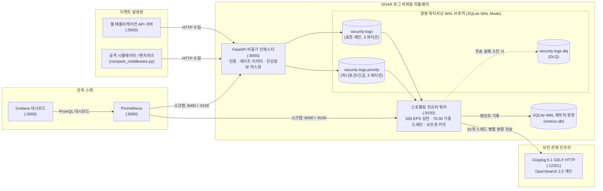

# SOAR 로그 버퍼링 및 트래픽 제어 미들웨어

대량 트래픽이나 침해 공격으로 로그가 급증할 때 하위 Graylog의 과부하를 방지하고 로그를 안정적으로 전달하는 경량 로그 파이프라인 미들웨어입니다.

---

## 빠른 시작: Graylog 연동 및 실행

### 1. Graylog 인풋 및 탐지 규칙 설정

#### 1.1 GELF HTTP 인풋 생성
1. Graylog 웹 콘솔(`http://127.0.0.1:9000`)에 접속합니다.
2. 상단 메뉴 System > Inputs로 이동합니다.
3. 드롭다운에서 GELF HTTP를 선택하고 Launch new input을 클릭합니다.
   - Global: 체크
   - Title: `Middleware GELF Ingest`
   - Port: `12201`
   - Bind address: `0.0.0.0`
4. Save를 클릭하고 인풋 상태가 RUNNING인지 확인합니다.

#### 1.2 SIEM 공격 탐지 규칙 등록
미들웨어가 500 EPS로 평탄화하여 전달한 로그를 기반으로 Graylog에서 공격 탐지 규칙을 생성합니다.
1. 무차별 대입 공격 탐지:
   - Alerts > Event Definitions > Create Event Definition
   - Title: `[S2] Brute Force Attack Detection` (Priority: High)
   - Condition Type: Aggregation
   - Search Query: `status_code:401 OR (event_type:APP_REQUEST AND status_code:401)`
   - Time Range: 1 minute, Execute every: 30 seconds
   - Group by Field: `client_ip`
   - Threshold: `count() >= 5` (1분 내 동일 IP에서 5회 이상 실패 시 경보)
   - Grace Period: 1 minute (동일 IP 중복 알람 억제)
   - Notifications: `S2 n8n Webhook (Brute Force)` 연결
2. 허니토큰 침입 탐지:
   - Title: `[S2] Honeytoken Infiltration Alert` (Priority: Critical)
   - Condition Type: Filter
   - Search Query: `_honeytoken_alert:true OR event_type:HONEYTOKEN_ACCESS`
   - Threshold: `count() > 0` (1회 발생 시 즉시 탐지)

---

### 2. 도커 컴포즈 실행
기본 설정은 호스트의 Graylog(`http://host.docker.internal:12201/gelf`)로 로그를 전달합니다. `.env` 파일의 `GRAYLOG_GELF_URL`에 쉼표(`,`)로 복수 주소를 지정할 수 있습니다. 첫 번째 주소에는 기존 재시도 및 오프셋 커밋 정책을 적용해 전송합니다. 추가 주소에는 동일 배치를 비동기로 복제 전송합니다.

```powershell
# scenario2-middleware 디렉터리로 이동
cd scenario2-middleware

# 환경변수 파일 복사 (필요 시 주소 변경)
Copy-Item .env.example .env

# 미들웨어 및 관측 스택(Prometheus, Grafana) 동시 실행
docker compose -f docker-compose.yml -f docker-compose.dev.yml --profile observability up -d --build

# 컨테이너 상태 확인
docker compose ps
```

상용 Graylog 없이 로컬 검증 서버로 단독 테스트할 때는 아래 명령을 실행합니다.
```powershell
docker compose -f docker-compose.yml -f docker-compose.mock.yml up -d --build
```

---

### 3. 모니터링 화면 접속
- Grafana 대시보드: `http://127.0.0.1:3000` (`SOAR Middleware Observability` 대시보드 및 Prometheus 데이터소스 자동 등록)
- Prometheus: `http://127.0.0.1:9090`
- 미들웨어 수집기 헬스체크: `http://127.0.0.1:8000/v1/health`
- 컨슈머 워커 메트릭: `http://127.0.0.1:9100/metrics`

---

### 4. 벤치마크 및 검증 스크립트 실행

```powershell
# 1. 상용 Graylog 정지(docker pause) 기반 듀얼 시나리오 벤치마크 (OpenSearch 실측)
python simulators/compare_middleware.py --mode distress --scenario all

# 2. 2만 건 스파이크 완충 및 5단계 원장 대사 검증
python simulators/spike_test_demo.py --spike-count 20000

# 3. 전체 단위 및 통합 테스트 스위트 실행
pytest -v
```

---

## 1. 핵심 설계 목표

### 1.1 트래픽 평탄화와 하위 인프라 보호
수천 건의 로그가 순간 유입될 때 FastAPI 기반 비동기 HTTP 수집기([`src/ingestor.py`](./src/ingestor.py), 포트 8000)가 요청을 지연 없이 수락합니다. 수신한 로그는 디스크 기반 WAL 브로커(`broker_wal.db`, 3개 파티션)에 버퍼링합니다. 백그라운드 컨슈머 워커([`src/consumer_worker.py`](./src/consumer_worker.py))는 토큰 버킷 레이트 리미터(`MAX_LOGS_PER_SEC=500.0`)와 마이크로 배칭(`BATCH_SIZE=100`, `BATCH_LINGER_MS=100`)을 적용합니다. 하위 Graylog가 수용할 수 있는 초당 500건 이하로 트래픽을 제어해 전달합니다.

### 1.2 At-Least-Once 전송과 선별 재시도
At-Least-Once 전송과 실패 건 선별 재시도를 조합하여 데이터 정합성을 유지합니다. 프로듀서는 인메모리 유계 큐와 백그라운드 배치 커밋 스레드를 통해 WAL 디스크에 기록합니다. 큐 용량이나 미소비 래그 한도를 넘어서면 HTTP 503 백프레셔를 반환하여 상위 서비스 장애 전파를 방지합니다.

컨슈머는 Graylog의 HTTP 2xx 응답이나 DLQ 격리를 확인한 뒤에만 파티션별 최대 오프셋(`max_offset + 1`)을 동기 커밋합니다. 상용 Graylog 6.1의 단건 수신 스펙에 맞춰 20개 스레드 병렬 분할 전송 모드(`GELF_SPLIT_POST=True`)를 운용합니다. 부분 실패가 발생하면 성공 건은 제외하고 실패한 인덱스(`pending_indices`)만 선별 재시도하여 중복 전송 부하를 줄입니다.

### 1.3 프로듀서 핫패스 논블로킹 아키텍처
수집 요청을 처리하는 `produce()` 핫패스에서 동기 SQLite 조회를 배제하여 이벤트 루프 블로킹을 방지했습니다. 미소비 큐 적체량(`unconsumed_lag`)은 FastAPI 라이프스팬 백그라운드 태스크가 `asyncio.to_thread`를 통해 1초 주기로 갱신합니다. 프로듀서는 인메모리 캐시값만 참조합니다. 토픽별 파티션 수는 런타임 불변 속성이므로 최초 1회 조회 후 인메모리에 캐싱합니다. 이를 통해 백그라운드 쓰기 스레드의 트랜잭션 락(`BEGIN IMMEDIATE`)과 수집 스레드 간 경합을 줄였습니다.

### 1.4 공격자 IP 기준 순서 보장과 70:30 가중 드레인
`client_ip`를 파티션 키로 지정(`crc32(client_ip) % 3`)합니다. 동일한 공격자 IP에서 발생한 연속 이벤트는 동일 파티션에 순차 적재하여 처리합니다. 허니토큰 접근(`HONEYTOKEN_ACCESS`)과 고위험 이벤트(`severity <= 2`)는 우선순위 토픽(`security-logs.priority`)으로 분기 라우팅합니다. 컨슈머는 70:30 가중 드레인 알고리즘을 사용합니다. 일반 로그 백로그가 누적된 상태에서도 허니토큰 경보를 지연 예산(2.0초 미만, 실측 0.045초) 내에 먼저 전달합니다. 동시에 표준 레인 지분을 최소 30% 보장하여 일반 트래픽의 기아 현상을 방지합니다.

---

## 2. Kafka 대신 자체 경량 WAL 브로커를 구현한 이유

대규모 분산 환경에서는 Apache Kafka가 표준이지만, 단일 노드 보안 인프라와 온프레미스 배포 환경을 고려해 자체 경량 WAL 브로커([`src/middleware/lightweight_broker.py`](./src/middleware/lightweight_broker.py), `broker_wal.db`)를 구현했습니다.

### 2.1 JVM 및 인프라 오버헤드 제거
Kafka 브로커는 JVM 기반으로 컨테이너당 수백 MB에서 1GB 이상의 메모리를 점유합니다. 기동과 메타데이터 동기화에도 시간이 걸립니다. 자체 브로커는 파이썬 표준 라이브러리와 SQLite WAL 모드(`PRAGMA journal_mode=WAL`)로 동작합니다. 컨테이너 384MB 메모리 제한 내에서도 가볍게 실행되며 기동 즉시 트래픽을 처리합니다.

### 2.2 C 바이너리 컴파일 의존성 제거
`confluent-kafka` 라이브러리는 C 기반 `librdkafka` 바이너리 빌드 의존성을 갖습니다. 반면 자체 브로커는 표준 SQLite 엔진을 활용합니다. 별도 C 컴파일 환경 없이 다양한 운영체제에서 동일하게 동작하도록 이식성을 확보했습니다.

### 2.3 Kafka 호환 인터페이스 유지
외부 브로커 프로세스는 사용하지 않지만 핵심 메시징 메커니즘을 동일하게 구현했습니다. IP 기반 CRC32 파티셔닝, 파티션별 단조 증가 오프셋, 컨슈머 그룹 오프셋 커밋, 워터마크 기반 래그 계산, Pause/Resume 기반 디큐 제어를 지원합니다. 추후 대규모 분산 환경으로 확장할 때 상위 비즈니스 로직 수정 없이 외부 Kafka 클라이언트로 교체할 수 있도록 덕 타이핑 인터페이스를 맞췄습니다.

---

## 3. 시스템 아키텍처



---

## 4. 실측 벤치마크 검증 요약

상용 Graylog 컨테이너 정지(`docker pause`) 조건에서 오픈루프 도착률 스케줄링과 3.0초 SLA 타임아웃을 적용해 검증했습니다.
OpenSearch Scroll API(`size=10000`)와 Python `set()`을 통해 실측 데이터를 검증했습니다.

```text
============================================================================================================================
 [RESILIENCE UNDER SIEM DISTRESS: COMPREHENSIVE DUAL-SCENARIO REPORT]
----------------------------------------------------------------------------------------------------------------------------
Metric                         | [Scenario A] 500 logs / 3s Pause           | [Scenario B] 20k logs / 15s Pause         
                               | Direct Graylog       | SOAR Middleware     | Direct Graylog       | SOAR Middleware    
----------------------------------------------------------------------------------------------------------------------------
Target Endpoint                | POST /gelf           | POST /v1/ingest     | POST /gelf           | POST /v1/ingest    
Client Concurrency             | 20 workers           | 20 workers          | 50 workers           | 50 workers         
Client Timeout                 | 3.0s                 | 3.0s                | 3.0s                 | 3.0s               
Client Retry Policy            | 1 Retry (0.5s)       | 0 (WAL Decoupled)   | 1 Retry (0.5s)       | 0 (WAL Decoupled)  
Downstream Distress            | Pause (3.0s)         | Pause (3.0s)        | Pause (15.0s)        | Pause (15.0s)      
----------------------------------------------------------------------------------------------------------------------------
Client Ingest Duration         | 3.89s                | 2.51s (WAL)         | 117.66s              | 117.67s (WAL)      
Client Ingest Throughput       | 128 req/s            | 199 logs/s          | 170 req/s            | 170 logs/s         
Service Latency (Pure RTT Avg) | 234.75 ms            | 9.89 ms             | 60.42 ms             | 12.01 ms           
  - Service P95 / P99          | 3003.6 / 3032.1 ms   | 19.4 / 27.5 ms      | 340.8 / 1049.2 ms    | 27.2 / 60.9 ms     
Total Latency (Queue+Wait Avg) | 2162.90 ms           | 9.86 ms             | 461.33 ms            | 12.24 ms           
  - Total P95 / P99            | 3000.0 / 3022.6 ms   | 30.5 / 39.8 ms      | 3000.0 / 3014.2 ms   | 36.8 / 68.2 ms     
Client Logs Accepted           | 295                  | 500                 | 17,757               | 20,000             
Client Logs Failed (Loss)      | 205                  | 0                   | 2,243                | 0                  
----------------------------------------------------------------------------------------------------------------------------
End-to-End Delivered (DB)      | 312 logs (312 uniq)  | 500 logs (500 uniq) | 18,356 logs (18,356 uniq) | 20,052 logs (20,000 uniq)
End-to-End Log Loss Rate       | 37.6% (188 lost)     | 0.0% (0 lost)       | 8.2% (1,644 lost)    | 0.0% (0 lost)      
End-to-End Duplicate Rate      | 0.0% (Clean)         | 0.0% (Clean)        | 0.0% (Clean)         | +0.3% (+52 dups)   
Architectural Verdict          | UNPROTECTED (188 lost) | 0 LOST, 0 DUPS (Observed) | UNPROTECTED (1,644 lost) | ZERO-LOSS (At-Least-Once, +52 dups)
============================================================================================================================
 * Note 1: 인제스터 단일 워커 최적 동시성(concurrency=50) 기준이며, 대규모 확장은 Kafka 전환 로드맵을 참조합니다.
 * Note 2: At-Least-Once 파이프라인으로 10초 초과 장기 다운타임 시 정상 재전송에 따른 중복이 발생할 수 있습니다.
 * Note 3: OpenSearch 적재 건수는 DB 실제 카디널리티 쿼리로 실측 검증했습니다(실패 시 UNVERIFIED 처리 후 sys.exit(2)).
```

### 핵심 시사점
1. **Direct Graylog 전송**:
   - 다운스트림이 정지하면 커넥션 풀 슬롯 50개가 고갈됩니다. 새로 유입되는 요청은 3.0초 SLA 내에 슬롯을 얻지 못해 유실됩니다.
   - 단기 장애(시나리오 A, 3초)에서 188건(37.6%), 장기 장애(시나리오 B, 15초)에서 1,644건(8.2%) 결측을 확인했습니다.
2. **SOAR 미들웨어**:
   - 하위 상태와 무관하게 로컬 WAL에 즉시 기록하여 클라이언트 체감 지연 시간을 12ms 안팎으로 유지합니다.
   - 20,000건을 유실 없이 수용하여 고유 데이터 20,000건을 보존했습니다.
   - 10초를 초과하는 다운타임(15초) 환경에서는 타임아웃에 따른 재전송으로 52건(+0.3%) 중복이 발생했으나 At-Least-Once 전송 특성에 맞게 동작함을 확인했습니다.
