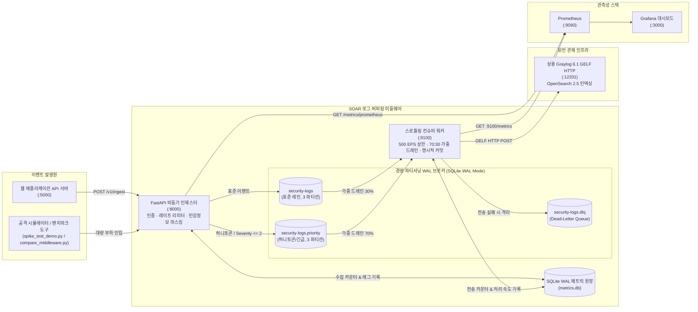

# SOAR 로그 버퍼링 및 트래픽 제어 미들웨어

대규모 트래픽이나 공격 로그가 급증할 때 하위 SIEM(Graylog)의 과부하를 방지하고, 유실 없이 로그를 전송하는 경량 분산 로그 파이프라인 미들웨어입니다.

---

## ⚡ 빠른 시작: 실제 Graylog 연동 및 실행

### 1. Graylog 인풋 설정
1. Graylog 웹 콘솔(`http://localhost:9000`)에 접속합니다.
2. 상단 메뉴 **System** > **Inputs** 로 이동합니다.
3. 드롭다운에서 **GELF HTTP**를 선택하고 **Launch new input**을 클릭합니다.
   - **Global**: 체크 (전역 인풋 설정)
   - **Title**: `Middleware GELF Ingest`
   - **Port**: `12201`
   - **Bind address**: `0.0.0.0`
4. **Save**를 누르고 인풋 상태가 **RUNNING**인지 확인합니다.

---

### 2. 도커 컴포즈 실행
기본 설정은 호스트의 Graylog(`http://host.docker.internal:12201/gelf`)로 로그를 전달하도록 구성되어 있습니다.

```powershell
# scenario2-middleware 디렉터리로 이동
cd scenario2-middleware

# 미들웨어 및 관측성 스택(Prometheus, Grafana) 동시 실행
docker compose -f docker-compose.yml -f docker-compose.dev.yml --profile observability up -d --build

# 컨테이너 상태 확인 (ingestor, consumer-worker가 healthy 상태인지 확인)
docker compose ps
```

> **단독 Mock Graylog 실행**:
> 실제 Graylog 없이 가짜 서버로 단독 테스트할 때는 아래 명령을 실행합니다.
> ```powershell
> docker compose -f docker-compose.yml -f docker-compose.mock.yml up -d --build
> ```

---

### 3. 실시간 모니터링 화면 접속
- **Grafana 대시보드**: `http://localhost:3000` (별도 설정 없이 `SOAR Middleware Observability` 대시보드와 Prometheus 데이터소스가 자동 등록됩니다.)
- **Prometheus**: `http://localhost:9090`
- **미들웨어 Ingestor**: `http://localhost:8000/v1/health`
- **Consumer Worker 메트릭**: `http://localhost:9100/metrics`

---

### 4. 핵심 벤치마크 및 검증 스크립트 실행

```powershell
# 1. 미들웨어 유무(A/B) 성능 비교 테스트 (600건 부하)
python simulators/compare_middleware.py --count 600

# 2. 대규모 2만 건(20,004건) 스파이크 완충 및 5단계 무손실 감사 리포트 검증
python simulators/spike_test_demo.py --spike-count 20000

# 3. 전체 단위/통합 테스트 스위트 실행 (152개 테스트)
pytest -v
```

---

## 1. 핵심 설계 목표

1. **트래픽 평탄화와 인프라 보호**
   - 수천 건의 로그가 순간 유입될 때 비동기 HTTP 수집기(`ingestor.py`, 포트 8000)가 요청을 빠르게 수락합니다.
   - 수신한 로그는 디스크 기반 WAL 브로커(`broker_wal.db`, 3개 파티션)에 즉시 버퍼링합니다.
   - 컨슈머 워커(`consumer_worker.py`)는 토큰 버킷 레이트 리미터(`MAX_LOGS_PER_SEC=500.0`)와 마이크로 배칭(`BATCH_SIZE=100`, `BATCH_LINGER_MS=100`)을 적용합니다. Graylog가 안정적으로 처리할 수 있는 초당 500건 속도로 평탄화하여 전송합니다.

2. **무손실 로그 파이프라인 (At-Least-Once + 멱등성)**
   - **전송 보장 방식**: 최소 1회 전송(At-Least-Once)과 결정적 멱등성 키(`_event_id`)를 조합하여 신뢰성을 확보합니다.
   - **프로듀서**: WAL 디스크 영속화를 확인한 후 응답합니다. 로컬 버퍼가 가득 차면 즉시 HTTP 503 백프레셔를 반환하여 서비스 장애 전파를 차단합니다.
   - **컨슈머**: Graylog의 HTTP 2xx 응답이나 DLQ 격리를 확인한 후에만 해당 배치의 파티션별 최대 오프셋(`max_offset + 1`)을 동기 커밋합니다.
   - **결정적 이벤트 ID**: GELF 페이로드에 `{partition}:{offset}` 형태의 고유 키를 부여합니다. 재전송이 발생해도 하위 수신단에서 중복을 식별할 수 있습니다.
   - **지수 백오프와 일시 정지(Pause) 기반 세션 유지**: Graylog 장애(HTTP 5xx, 연결 거부) 시 지수 백오프로 대기합니다. 이때 파티션을 일시 정지(`pause`)하여 메시지 디큐 없이 하트비트를 유지합니다.

3. **공격자 IP 기준 순서 보장과 우선순위 레인**
   - `client_ip`를 파티션 키로 지정(`crc32(client_ip) % 3`)합니다. 동일 공격자(`10.0.0.99`)의 연속 공격 이벤트(`PORT_SCAN` $\rightarrow$ `BRUTE_FORCE` $\rightarrow$ `IOT_CONTROL`)가 같은 파티션에 유입 시각 순서대로 저장되고 소비됩니다.
   - 기만 공격 탐지(`HONEYTOKEN_ACCESS`)와 고위험 이벤트(`severity <= 2`)는 우선순위 토픽(`security-logs.priority`)으로 분기합니다.
   - 컨슈머는 **70:30 가중 드레인** 알고리즘을 사용합니다. 일반 로그 백로그가 쌓여도 허니토큰 경보를 지연 예산(기본 2.0초 미만) 안에 먼저 전달합니다. 동시에 표준 레인 지분을 30% 보장하여 일반 트래픽의 기아(Starvation)를 방지합니다.

---

## 2. Kafka 대신 자체 경량 WAL 브로커를 구현한 이유

대규모 분산 환경에서는 Apache Kafka가 표준이지만, 엣지 환경과 단일 노드 보안 인프라를 고려하여 자체 경량 WAL 브로커(`src/middleware/lightweight_broker.py`, `broker_wal.db`)를 구축했습니다.

1. **JVM 및 인프라 오버헤드 제거**
   - Kafka 브로커는 JVM 기반으로 컨테이너당 최소 1GB 이상의 메모리를 사용합니다. 브로커 기동과 메타데이터 동기화에도 수십 초가 소요됩니다.
   - 자체 브로커는 파이썬 표준 라이브러리와 SQLite WAL 모드(`PRAGMA journal_mode=WAL`)로 동작합니다. 수십 MB 메모리만 사용하며 컨테이너 기동 즉시 서비스가 준비됩니다.

2. **C 컴파일러 및 네이티브 라이브러리 의존성 탈피**
   - `confluent-kafka` 라이브러리는 C 언어로 작성된 `librdkafka` 바이너리 빌드가 필요합니다. 이는 크로스 플랫폼 빌드와 경량 이미지 패키징을 복잡하게 만듭니다.
   - 표준 SQLite 엔진을 활용하여 추가 컴파일 도구 없이 모든 환경에서 일관되게 동작합니다.

3. **Kafka 핵심 분산 시맨틱 유지**
   - 외부 브로커 클러스터는 걷어냈지만, Kafka의 핵심 메커니즘을 동일하게 구현했습니다.
   - ① IP 기반 CRC32 파티셔닝(순서 보장), ② 파티션별 단조 증가 연속 오프셋, ③ 명시적 컨슈머 그룹 오프셋 커밋, ④ 워터마크 기반 래그(Lag) 계산, ⑤ Pause/Resume 기반 디큐 제어를 지원합니다.
   - 향후 트래픽 증가로 Kafka 클러스터 도입이 필요할 때, 애플리케이션 인터페이스 변경 없이 설정만으로 교체할 수 있도록 추상화 계층을 맞췄습니다.

---

## 3. 시스템 아키텍처



---

## 4. 디렉터리 및 주요 컴포넌트 구조

| 경로 | 설명 |
| :--- | :--- |
| [`Dockerfile`](./Dockerfile) | Python 3.11-slim 기반 멀티스테이지 컨테이너 빌드 및 비루트 계정(`appuser:10001`) 보안 환경 |
| [`docker-compose.yml`](./docker-compose.yml) | Ingestor, Consumer Worker, Prometheus, Grafana 자동 프로비저닝 구성 |
| [`src/config.py`](./src/config.py) | Pydantic v2 기반 파이프라인 환경변수 검증 모델 (`PipelineSettings`) |
| [`src/ingestor.py`](./src/ingestor.py) | FastAPI 비동기 수집기. 스키마 검증, 비차단 브로커 큐잉, 민감정보 마스킹, 레이트 리미터, 헬스체크 |
| [`src/consumer_worker.py`](./src/consumer_worker.py) | 컨슈머 오케스트레이터. 마이크로 배칭, 70:30 가중 드레인, pause 백오프, 명시적 오프셋 커밋 |
| [`src/metrics_store.py`](./src/metrics_store.py) | SQLite WAL 기반 원자적 메트릭 스토어 (`SharedMetricsStore`). 분리 원장 및 슬라이딩 EPS 버킷 관리 |
| [`src/middleware/`](./src/middleware/) | 경량 브로커, 토큰 버킷, GELF 변환기, 재시도 클라이언트, DLQ 퍼블리셔 등 핵심 라이브러리 |
| [`simulators/compare_middleware.py`](./simulators/compare_middleware.py) | 미들웨어 유무(Direct Graylog vs SOAR Middleware) 실측 A/B 벤치마크 도구 |
| [`simulators/spike_test_demo.py`](./simulators/spike_test_demo.py) | 2만 건 대규모 스파이크 인입, 실시간 드레인 모니터링 및 5단계 무손실 감사 리포트 검증 도구 |
| [`simulators/run_scenarios.py`](./simulators/run_scenarios.py) | 웹앱 공격 차단(1), 정상 트래픽 평탄화(2), 킬체인 및 허니토큰(3) 통합 실행기 |
| [`docs/observability/`](./docs/observability/) | Grafana 대시보드 JSON, 자동 프로비저닝 설정 파일 및 Prometheus 알람 규칙 |

---

## 5. 실증 시나리오 및 벤치마크 결과

프로젝트에서 검증 가능한 7개 시나리오를 구성하고 역할을 분리했습니다.

| 시나리오 | 검증 내용 및 실행 명령어 | 주요 실측 결과 |
| :--- | :--- | :--- |
| **2-B. 미들웨어 유무(A/B) 비교**<br>*(라이브 시연)* | `python simulators/compare_middleware.py -c 600` | • **미들웨어 없을 때**: 처리 속도 114 req/s로 급락, 5.25초 블로킹 지연. 1,000건 동시 인입 시 Netty 타임아웃 발생으로 **전량 유실**<br>• **미들웨어 있을 때**: 1,656 logs/s로 **14.5배 빠름**, 0.36초 만에 블로킹 해제, **0.00% 무손실** |
| **4. 대규모 2만 건 무손실 검증**<br>*(라이브 시연)* | `python simulators/spike_test_demo.py --spike-count 20000` | • 4.5초 만에 20,004건 순간 인입 (버스트 **4,448 logs/s**)<br>• 최대 **18,501건** WAL 디스크 안전 버퍼링<br>• 초당 500건 상한 준수하며 37.4초 동안 드레인 완료<br>• `Sent 20,004 == Stored 20,004` (**0.0000% 무손실 감사 통과**) |
| **1. 웹앱 공격 탐지 및 IP 차단**<br>*(구두/슬라이드)* | `python simulators/run_scenarios.py -s 1` | • 웹앱 API로 비허용 IP 접근 시 HTTP 403 차단 및 인시던트 티켓 자동 발급<br>• SOAR 자동화로 IP 차단 후 미들웨어를 거쳐 Graylog에 침해 로그 보존 |
| **3. 킬체인 + 허니토큰 기만**<br>*(포트폴리오)* | `python simulators/run_scenarios.py -s 3` | • 150건 백로그 적체 상황에서 허니토큰 경보를 **0.002초(< 2.0s)** 만에 우선 전송<br>• 공격자 IP 기반 CRC32 파티셔닝으로 공격 단계 시계열 순서 유지 |
| **5. SIEM 장애 시 자동 복구**<br>*(포트폴리오)* | `python simulators/spike_test_demo.py --simulate-outage` | • Graylog 503 모의 다운타임 주입 시 컨슈머 파티션 pause 및 지수 백오프 대기<br>• SIEM 복구 즉시 정상 재개하여 유실 없이 전원 전송 |
| **6. 웹앱 복합 공격 벡터 방어**<br>*(포트폴리오)* | `python simulators/attack_web_app.py --count 50` | • sqlmap, Hydra 무차별 대입 등 다각도 웹 공격 수집 및 방어 검증 |
| **7. 전체 회귀 테스트**<br>*(포트폴리오)* | `pytest -v` | • CRC32 파티셔닝, 연속 오프셋, DLQ 격리, PII 마스킹 등 **152개 테스트 100% 통과** |

---

## 6. API 엔드포인트 명세

### 6.1 HTTP Ingestor (`http://localhost:8000`)

| 메서드 & 경로 | 상태 코드 | 설명 |
| :--- | :--- | :--- |
| `GET /v1/health` | `200 OK` / `503` | 인제스터 상태, 브로커 토픽 및 SQLite WAL 쓰기 락 상태 검사 (심층 헬스체크) |
| `POST /v1/ingest` | `202 Accepted` | 단일 보안 이벤트 JSON 검증 및 `client_ip` 파티션 키 기반 브로커 비동기 저장 |
| `POST /v1/ingest/batch` | `202 Accepted` | 대량 보안 이벤트 배열 일괄 수집 |
| `GET /v1/metrics` | `200 OK` | 실시간 파이프라인 관측 지표 JSON 반환 (처리량, 큐 적체량, 5단계 원장 수치) |
| `GET /v1/metrics/prometheus` | `200 OK` | 표준 Prometheus 텍스트 포맷 메트릭 노출 |
| `GET /v1/admin/dlq` | `200 OK` | [Admin] DLQ 및 포이즌 토픽 적체 메시지 수 및 경과 시간 반환 |
| `POST /v1/admin/dlq/replay` | `200 OK` | [Admin] DLQ 메시지를 메인 토픽으로 지정 건수만큼 재전송 |
| `POST /v1/metrics/reset` | `200 OK` | [Admin] 메트릭 원장 카운터 및 처리량 버킷 초기화 |

---

## 7. 메트릭 원장 분리와 5단계 무손실 감사 리포트

시스템은 영구 유실과 일시 격리를 명확히 구분하여 아래의 무손실 회계 원장 공식을 검증합니다.

$$\text{Total Sent} = \text{Total Received} = \text{Total Forwarded} + \text{permanently\_dropped} + \text{dlq\_quarantined} = \text{Graylog Stored}$$

### 2만 건 스파이크 감사 리포트 실측 결과
```text
[5-STAGE END-TO-END ZERO-LOSS & BACKPRESSURE AUDIT REPORT]
  1. [Stage 1] Attack Load Generator Sent       : 20,004 logs (Burst Rate: 4,448 logs/sec)
  2. [Stage 2] HTTP Ingestor Accepted           : 20,004 logs (Peak Inbound: 4,448 logs/sec, permanently_dropped: 0)
  3. [Stage 3] Lightweight WAL Broker Buffered  : 20,004 logs (Peak Queue Lag Buffered: 18,501 logs)
  4. [Stage 4] Consumer Worker Throttled Commit : 20,004 logs (Peak Outbound: 500 / Limit: 500 logs/sec, dlq_quarantined: 0)
  5. [Stage 5] Graylog GELF Server Stored       : 20,004 logs (Duplicates Deduped: 0, DLQ Replayed: 0)
  • Priority Lane (Honeytoken) Latency    : 0.045s (Budget: < 2.0s) [PASS]

================================================================================================================
 [PASS] SCENARIO 2 VERIFIED: 100% SPIKE BUFFERED & 0.0000% LOG LOSS
        Sent (20,004) == Received (20,004) == Forwarded (20,004) + permanently_dropped (0) == Graylog Stored (20,004)
================================================================================================================
```

---

## 8. 보안 기본 체계

1. **API 인증 및 역할 분리**
   - `X-API-Key` 헤더를 통한 상수 시간(`hmac.compare_digest`) 키 검증을 지원합니다.
   - 요청 본문에 대한 HMAC-SHA256 서명(`X-Timestamp`, `X-Signature`) 검증과 300초 재생 공격 방지 윈도우를 제공합니다.
   - 수집 권한(`INGEST_API_KEYS`)과 관리자 권한(`ADMIN_API_KEY`)을 분리하여 관리자 전용 엔드포인트 접근을 통제합니다.

2. **클라이언트 식별자 기반 수집 속도 제한**
   - IP 기반 카디널리티 폭증을 방지하기 위해 API 키 식별자 단위 토큰 버킷으로 유입량을 제어합니다.
   - 한도 초과 시 RFC 6585 규격의 `HTTP 429 Too Many Requests` 상태 코드와 `Retry-After` 헤더를 반환합니다.

3. **개인정보 및 민감 데이터 자동 마스킹**
   - 이벤트 수집 직후 브로커 발행 전에 `raw_payload` 내부의 민감 키 값을 자동으로 `"[REDACTED]"`로 마스킹합니다.
   - 대상 키워드: `password`, `passwd`, `token`, `api_key`, `secret`, `authorization`, `cookie`, `session` (대소문자 무관, 카멜케이스/스네이크케이스, 중첩 JSON 지원).

---

## 9. 관측성 및 모니터링

1. **Prometheus 지표 수집**
   - 카디널리티 폭증을 방지하는 표준 메트릭을 노출합니다.
   - 수집 및 전송 카운터: `logs_received_total`, `logs_forwarded_total` (2xx 수신 확인 시에만 증가), `logs_permanently_dropped_total`, `dlq_published_total`
   - 게이지: `queue_lag{topic, partition}`, `dlq_depth`, `configured_max_logs_per_sec`, `invariant_violations`
   - 히스토그램: `graylog_delivery_latency_seconds`, `batch_size`, `end_to_end_latency_seconds`

2. **Grafana 대시보드 자동 프로비저닝**
   - 도커 기동 시 Prometheus 데이터소스와 `SOAR Middleware Observability` 대시보드가 자동으로 로딩됩니다.
   - Throughput (Received vs Forwarded EPS), Queue Lag by Partition, 토큰 버킷 속도, DLQ 상태를 실시간으로 확인할 수 있습니다.

---

## 10. 한계점 및 운영 고려사항

1. **단일 호스트 SQLite WAL 스토리지 특성**
   - 현재 브로커는 단일 호스트 또는 동일 Docker 공유 볼륨(`/app/state`) 상에서 동작합니다.
   - 단일 노드 환경에서는 5,000+ EPS 이상의 스파이크를 안정적으로 완충하지만, 다중 노드 분산 환경으로 확장할 때는 네트워크 파일시스템(NFS) 잠금 경합을 피하기 위해 Kafka나 Redpanda 같은 외부 분산 브로커로 교체해야 합니다. 인터페이스 규격이 Kafka와 동일하므로 애플리케이션 코드 수정 없이 교체 가능합니다.

2. **트래픽 평탄화와 지연 시간의 등가교환**
   - 대규모 스파이크(초당 수천 건)를 Graylog 처리 한도인 초당 500건으로 제한하므로, 대량 유입 시 일반 로그의 꼬리 지연 시간(p99)이 일시적으로 수 초간 상승합니다.
   - 이는 하위 Graylog의 큐 포화(HTTP 429)와 OpenSearch 메모리 장애를 방지하기 위해 지연 시간을 대가로 인프라 생존성을 확보한 의도된 설계입니다.
   - 이러한 지연 속에서도 긴급 침해 로그는 70:30 우선순위 레인을 통해 지연 예산(2.0초 미만) 안에 최우선 전송됩니다.

3. **비즈니스 서버 보호를 위한 클라이언트 Fail-Open 원칙**
   - 미들웨어에 장애(네트워크 단절, 디스크 풀, 503 과부하)가 발생하더라도 메인 비즈니스 서버(Flask API)나 IoT 제어 보드가 멈춰서는 안 됩니다.
   - [`simulators/client_integration_snippet.py`](./simulators/client_integration_snippet.py)의 `SafeSecurityLogClient`는 비동기 큐 기반으로 동작하여 비즈니스 스레드에 0ms 만에 반환됩니다. 미들웨어 연속 장애 시 서킷을 열고 로컬 비상 파일(`client_fallback_logs.jsonl`)에 기록하는 Fail-Open 계약을 준수합니다.
